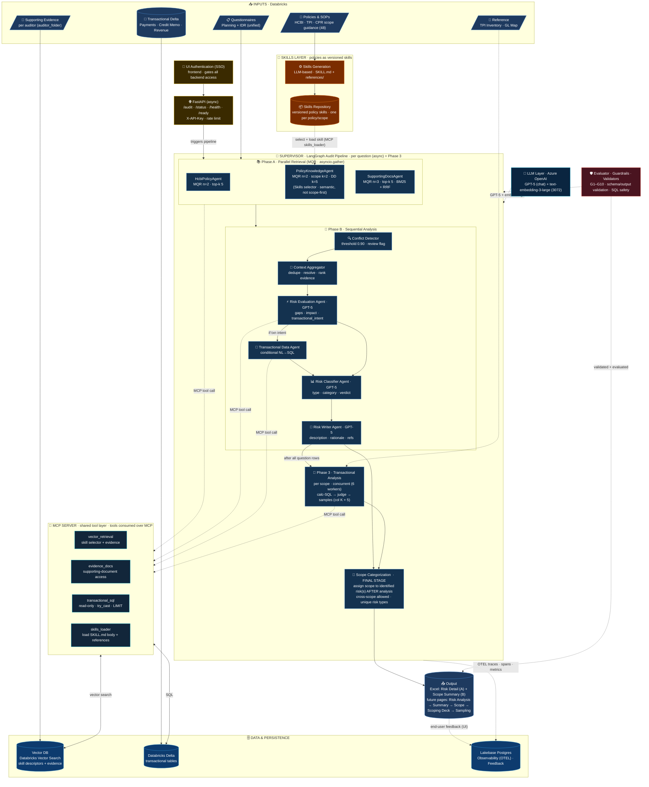

# AI Auditor — Architecture & Flow Diagrams

---

## 0. Current Build — What Changed

- **Phase 0 — ScopeIdentifierAgent** added as the first LangGraph node. Analyses the full question + response + follow-up context and identifies which of the **48 FCPA audit scope areas** apply. Output is a 4-line block: `Primary Scope`, `Additional Scopes`, `Reasoning`, `Confidence`. **Three-tier confidence routing** (in `AuditSupervisor`): `≥ 0.70` use the identified scope(s) as-is; `0.50–0.69` use the identified scope(s) **including any additional scopes** (broader net); `< 0.50` (or no scope after one retry) fall back to **unfiltered retrieval** across all scopes via the `ANY_SCOPE` sentinel — **not** a forced `DUE_DILIGENCE`. Retries once if no scopes are returned.

- **fcpa_scope_policy_index** — Databricks Vector Search index built from `CPR AI - System Guide.xlsx`. **144 chunks** (48 scope areas × 3 chunk types per area): `risk_profile` (cols C+D+E+F+G+H+P — scope desc, red flags, policies, audit steps, name of data, source of data, guidelines), `audit_guidance` (cols F+O), and `sampling_guidance` (cols I+J+K — data calculations, sampling rationale, expected sample size). Ingested via `CPRScopeExtractor`. A dedicated `scripts/reingest_scope_policy_index.py` refreshes it in place (upsert, no delete).

- **PolicyKnowledgeAgent routing** — always calls `retrieve_scope_area_policy(query, scope_id)` against `fcpa_scope_policy_index`; calls `retrieve_due_diligence_policy(query)` against `tpi_due_diligence_index` **only** when identified scope is `DUE_DILIGENCE`. When the injected scope is `ANY_SCOPE`, the scope-policy tool runs **unfiltered** (no `scope_id` filter, widened top-k) so low-confidence questions still retrieve the most relevant guidance across all scopes.

- **BM25Reranker on EvidenceRetrievalTool** — `rank-bm25` BM25Okapi re-ranks a `top_k × 4` semantic candidate pool using RRF fusion: `1/(60+sem_rank) + 1/(60+bm25_rank)`. Corrects semantic ranking misses for exact document names (e.g. `Starters_Leavers_Report_Q3.pdf`).

- **MultiQueryRetriever (MQR)** extended to all retrieval tools: HCBI (n=2 alternatives), Policy (n=2), Evidence (n=3). LLM generates alternative phrasings; results deduplicated by `chunk_id` keeping highest `similarity_score`.

- **Async retrieval everywhere** — `aretrieve()` added to all 4 retrieval tools. `MQR.aretrieve()` uses `asyncio.gather + asyncio.to_thread` for parallel non-blocking searches. Phase A runs all 3 agents fully non-blocking via `asyncio.gather`.

- **Multi-auditor supporting docs** — `auditor_folder` column added to `auditor_supporting_docs_index`. Each auditor's files (e.g. `Sam_1/`, `Kaitlyn_1/`, `Naeem_1/`) ingested into a single shared index, tagged by subfolder name. Retrieval filtered by `AUDITOR_ID` env var at runtime.

- **AUDITOR_ID env var** — replaces the hardcoded `current_auditor_folder` setting. Set once per run (`AUDITOR_ID=Sam_1`); controls which questionnaire rows load and which supporting docs folder is searched.

- **8-agent pipeline** — pipeline now has: `ScopeIdentifierAgent` (Phase 0) → `HcbiPolicyAgent + PolicyKnowledgeAgent + SupportingDocsAgent` (Phase A, parallel) → `RiskEvaluationAgent → TransactionalDataAgent → RiskClassifierAgent → RiskWriterAgent` (Phase B, sequential).

- **Universal guardrails G1–G10** on all 8 agent system prompts: G1–G6 cover hallucination, invented data, bias, FCPA scope, no legal advice, PII protection; G7–G10 cover valid scope IDs, exact output format, no risk assessment in scope agent, confidence calibration.

- **Vector index names (v2)** — `hcbi_policy_index`, `tpi_due_diligence_index`, `auditor_supporting_docs_index`, `fcpa_scope_policy_index`.

- **FastAPI layer** — `/audit` (POST, async pipeline trigger), `/status/{job_id}` (poll result), `/health` (liveness), `/ready` (readiness) endpoints. `X-API-Key` auth middleware. `AuditRequest` / `AuditResponse` Pydantic schemas with full validation.

- **Embedder** — Azure OpenAI `text-embedding-3-large`, **3072 dimensions** (all 4 indexes).

- **Phase 3 — TransactionalDataAnalysisAgent fully redesigned (AI-driven, per-scope).** No hardcoded checks. It iterates **every scope area** (all 48; no scope skipped) and, for each: (1) turns that scope's **Data Calculations** (CPR col I) into SQL — or uses its own FCPA intelligence when the guidance is thin; (2) executes it to get scope-specific computed data; (3) judges a **single consolidated risk assessment**; (4) when a risk is present, pulls samples sized to **Expected Sample Size (CPR col K) + 5 buffer**, forced to `SELECT *` so the full transaction row is captured. **One row per scope** (~48 rows), scopes analysed **concurrently** (thread pool, `_SCOPE_ANALYSIS_WORKERS = 6`). SQL safety: `SELECT`-only, `try_cast` for STRING-typed numeric columns, deterministic `LIMIT` override, exact source table taken from the executed query's `FROM` clause.

- **Risk Category — 6-rule business bifurcation** in the classifier, with two enforced anchors (High ⇒ Potential Risk; No Risk ⇔ No Risk Identified). Risk Type (evidence axis) and Risk Category (severity axis) are **independent**. **Excel row colouring by Risk Category**: High = red, Medium/Low = yellow, No Risk = no fill.

- **New output columns** — `Scope Area Reasoning` (why a scope was assigned) and `Samples` (the pulled transaction rows for a Phase 3 risk). Summary sheet counts resolve columns **by header name** and report only Potential Risk / Further Review Required / No Risk.

- **UI Authentication (SSO)** — access control is handled on the **UI (frontend)**; the whole backend described here is one part of the wider system. Every request is authenticated (SSO) on the UI before it reaches the FastAPI entry. Shown in the architecture as the front-most component for completeness.

- **LLM Layer (shared)** — a single Azure OpenAI initialisation used everywhere: **GPT-5** for chat completions (all 8 agents, Phase 3, MQR query generation) via `AzureOpenAILLMProvider`, and **text-embedding-3-large (3072-dim)** for embeddings (ingestion + all retrieval) via `AzureOpenAIEmbeddingProvider`.

- **Evaluator · Guardrails · Validators (cross-cutting)** — a single governance box spanning the pipeline: prompt guardrails G1–G10, Pydantic schema + structured-output validation, SQL safety (SELECT-only · try_cast · deterministic LIMIT), and output evaluation/quality scoring before a row is written.

- **Persistence on Lakebase Postgres** — two stores: an **Observability Store** capturing traces / spans / metrics / logs from every agent and the pipeline via the **OpenTelemetry (OTEL)** protocol; and a **Feedback Table** holding end-user feedback captured on the UI (rating + comments, keyed to job / question / scope).

---

## 1. System Architecture Diagram

```mermaid
flowchart LR

    %% ─────────────────── UI AUTHENTICATION (FRONTEND) ───────────────────
    subgraph AUTHN["🔐  UI AUTHENTICATION (SSO)  ·  frontend — this backend is one part of the wider system"]
        direction TB
        SSO["UI Authentication (SSO)\nUser login · identity & access control\nPerformed on the UI (frontend)\nGates every request before it reaches the backend"]
    end

    %% ─────────────────── INPUT LAYER ────────────────────────────────────
    subgraph INPUT["📥  INPUT LAYER"]
        direction TB
        subgraph QIN["Questionnaire Data · Databricks Delta Tables"]
            PQ[("📋 Planning\nQuestionnaire")]
            IDR[("📋 IDR Questionnaire\ndata_and_report_request\n(full question text)")]
        end
        subgraph DOCS["Policy & Evidence Documents · Databricks Volumes"]
            HCBI[/"📄 HCBI Global Policy\nTV-POL-02257_v3.0.pdf\n115 pages · image-based PDF"/]
            LP[/"📄 TPI Due Diligence Policies\nTPEC · Red Flag · SOP · BGS\nPDFs + .doc"/]
            CPR[/"📊 CPR Scope Area Policy\nCPR AI - System Guide.xlsx\n48 scope areas · risk + guidance"/]
            SD[/"📎 Supporting Documents\nauditors_supporting_documents/\nSam_1/ · Kaitlyn_1/ · Naeem_1/ ...\n.pdf  .xls  .ppt  .pptx  .docx  .html  .msg"/]
        end
        subgraph REF["Reference Files · Databricks Volumes"]
            INV[/"📋 TPI Inventory\nTPI_Inventory_Final_Output.xlsx"/]
            GL[/"📊 HCC GL Account Map\nHCC_GL_Account_Map-11142023.xlsx"/]
        end
        subgraph TXN["Transactional Data · Databricks Delta Tables"]
            TD1[("💳 Payments\nDashboard Summary")]
            TD2[("📋 Credit Memo\n& Returns")]
            TD3[("📈 Revenue\nDashboard Summary")]
        end
    end

    %% ─────────────────── DOCUMENT INTELLIGENCE ──────────────────────────
    subgraph DI["🔧  DOCUMENT INTELLIGENCE  ·  async  ·  startup ingestion"]
        direction TB
        UDL["Universal Document Loader\nRoutes by file format\nRecursive directory walk\nDocumentType: GLOBAL_POLICY\n/ TPI_POLICY / SUPPORTING_DOC"]
        subgraph EXT["Format Extractors"]
            direction LR
            E1["OCR\nTesseract (fallback)\nAzure Doc Intelligence\n(prebuilt-read · production)"]
            E2["PDF\npdfplumber (text layer)\nPyMuPDF → OCR (image pages)"]
            E3["Office / Web / Mail\npython-pptx · python-docx\nopenpyxl · BeautifulSoup\nextract-msg"]
        end
        CPRX["CPRScopeExtractor\n48-sheet → scope_id mapping\nCols C+D+E+F+G+H+P → risk_profile\nCols F+O → audit_guidance\nCols I+J+K → sampling_guidance\n144 chunks total (48 × 3)"]
        CHK["Section-Aware Chunker\n≤ 800 tokens · 100-token overlap\nBuilds DocumentChunk (scope_id,\nauditor_folder, source, metadata)"]
        EMB["Embedder\nAzure OpenAI\ntext-embedding-3-large\n3072 dimensions"]
    end

    %% ─────────────────── VECTOR STORE ───────────────────────────────────
    subgraph VS["🗄️  DATABRICKS VECTOR SEARCH  ·  v2 indexes  ·  auditor_folder column on all"]
        direction TB
        HI[("hcbi_policy_index\nHCBI Global Policy\nscope_id = 'global'")]
        LPI[("tpi_due_diligence_index\nTPI Local Policies\nscope_id per policy")]
        SDI[("auditor_supporting_docs_index\nEvidence Documents\nauditor_folder = 'Sam_1' etc.\nfiltered by AUDITOR_ID at query time")]
        SPI[("fcpa_scope_policy_index\n144 chunks · 48 scope areas\nrisk_profile + audit_guidance\n+ sampling_guidance\nper scope_id")]
    end

    %% ─────────────────── FASTAPI LAYER ──────────────────────────────────
    subgraph API["🌐  FASTAPI LAYER  ·  async"]
        direction TB
        EP1["POST /audit\nAuditRequest → job_id\n(async background task)"]
        EP2["GET /status/{job_id}\nAuditResponse when complete"]
        EP3["GET /health · GET /ready\nliveness · readiness probes"]
        AUTH["X-API-Key middleware\n401 on missing/invalid key\nInput sanitization\nRate limit: 10 req/min"]
    end

    %% ─────────────────── LANGGRAPH PIPELINE ─────────────────────────────
    subgraph GRAPH["🤖  LANGGRAPH 8-AGENT PIPELINE  ·  per question  ·  QUESTION_CONCURRENCY concurrent  ·  async"]
        direction TB

        subgraph P0["Phase 0 — Scope Identification"]
            SIA["🔎 ScopeIdentifierAgent\n48 FCPA scope areas\n4-line output:\nPrimary Scope · Additional Scopes\nReasoning · Confidence\nRetry once if empty\nThree-tier routing:\n≥0.70 scope · 0.50–0.69 scope+additional\n<0.50 → ANY_SCOPE (unfiltered)"]
        end

        subgraph PA["Phase A — Parallel Retrieval  ─  asyncio.gather()"]
            direction LR

            subgraph HPA_G["HCBI Policy Agent"]
                MQR_H["MQR n=2\nalternative phrasings\nvia LLM.ainvoke()"]
                HPA["HcbiPolicyAgent\nhcbi_policy_index\ntop-k=5"]
            end

            subgraph PKA_G["Policy Knowledge Agent"]
                PKA["PolicyKnowledgeAgent\nTool 1 (always):\nretrieve_scope_area_policy\n→ fcpa_scope_policy_index\ntop-k=2 (ANY_SCOPE → unfiltered, wide)\n\nTool 2 (DUE_DILIGENCE only):\nretrieve_due_diligence_policy\n→ tpi_due_diligence_index\ntop-k=5\nMQR n=2"]
            end

            subgraph EAA_G["Supporting Docs Agent"]
                MQR_E["MQR n=3\nalternative phrasings"]
                BM25["BM25Reranker\nRRF fusion\n1/(60+sem) + 1/(60+bm25)\ncandidate pool = top_k × 4"]
                EAA["SupportingDocsAgent\nauditor_supporting_docs_index\nfiltered: auditor_folder = AUDITOR_ID\ntop-k=5"]
            end
        end

        subgraph PB["Phase B — Sequential Analysis"]
            direction TB
            CD["🔍 Conflict Detector\nCross-row semantic similarity\nInMemoryStore · threshold 0.90\n+ response divergence\n→ Further Review Required flag"]
            REA["⚡ RISK EVALUATION AGENT\nAzure OpenAI GPT-5\nIdentifies compliance gaps\nAssesses impact & risk level\nSets transactional_intent flag"]
            TDA["💾 Transactional Data Agent\nNL-to-SQL — CONDITIONAL\nCalled only when quantitative\nsignal detected in response\nDelta tables: Payments · Credit Memo · Revenue"]
            RCA["📊 RISK CLASSIFIER AGENT\nAzure OpenAI GPT-5\n9-field classification block:\nRisk Type · Risk Category\nEvidence Verdict · Pattern Match\nScenario Match · Key Policy Req\nKey Evidence Gap · GL Mismatch\nScope Determination"]
            RWA["📝 RISK WRITER AGENT\nAzure OpenAI GPT-5\nTranslates classification block\ninto final output fields:\nRisk Type · Risk Description\nRisk Rationale · Risk Category (+reasoning)\nScope Area · Scope Area Reasoning\nDocument Reference · Risk Summary\nIncremental Excel save per question"]
        end
    end

    %% ─────────────────── PHASE 3 ─────────────────────────────────────────
    subgraph P3["🔎  PHASE 3  ·  TransactionalDataAnalysisAgent  ·  AI-driven · per scope (all 48) · concurrent (6 workers)"]
        direction TB
        P3G["Load CPR guidance for ALL 48 scopes\n(risk profile · red flags · data calcs ·\nsampling rationale · expected sample size)"]
        P3C["Per scope — Step 1 & 2:\nLLM turns Data Calculations → SQL\n(or uses FCPA intelligence if thin)\nExecute → scope-specific computed data"]
        P3J["Per scope — Step 3:\nLLM judges ONE consolidated assessment\nRisk Type · Category · Description · Rationale"]
        P3S["Per scope — Step 4 (if risk):\nSELECT * samples · LIMIT = col K + 5\nExact source table from FROM clause"]
        P3R["One RiskOutput row per scope (~48)\nNo Risk scopes emit a row (no samples)"]
    end

    %% ─────────────────── OUTPUT ──────────────────────────────────────────
    subgraph OUTPUT["📤  OUTPUT  ·  ALL rows written  ·  Potential Risk + Further Review + No Risk Identified"]
        direction TB
        OUTXL[("📊 FCPA_Audit_<AUDITOR_ID>_<timestamp>.xlsx\nOutput A - Risk Detail (per question + Phase 3)\nOutput B - Scope Summary\nRow colour by Risk Category:\nHigh=red · Medium/Low=yellow · No Risk=none")]
        OF["Risk Title · Risk Type\nRisk Category · Risk Category Reasoning\nRisk Rationale · Risk Description\nScope Area · Scope Area Reasoning\nEvidence Explanation · Calculation Evidence\nSamples · Source Details\nQuestion · Response · Follow-up Q / R"]
    end

    %% ─────────────────── LLM LAYER (SHARED) ─────────────────────────────
    subgraph LLML["🧠  LLM LAYER  ·  Azure OpenAI  ·  initialised once, shared by all components"]
        direction TB
        LLM_CHAT["Azure OpenAI GPT-5\nChat completions · streaming\nAzureOpenAILLMProvider\nUsed by: all 8 agents · Phase 3 · MQR query generation"]
        LLM_EMB["Azure OpenAI text-embedding-3-large\n3072 dimensions\nAzureOpenAIEmbeddingProvider\nUsed by: Embedder (ingestion) · all vector retrieval"]
    end

    %% ─────────────────── GOVERNANCE (CROSS-CUTTING) ─────────────────────
    subgraph GOV["🛡️  EVALUATOR · GUARDRAILS · VALIDATORS  ·  cross-cutting quality & control"]
        direction TB
        GV["Evaluator · Guardrails · Validators\nPrompt guardrails G1–G10 on every agent\nPydantic schema + structured-output validation\nSQL safety: SELECT-only · try_cast · deterministic LIMIT\nOutput evaluation / quality scoring before write"]
    end

    %% ─────────────────── PERSISTENCE · LAKEBASE POSTGRES ────────────────
    subgraph PERSIST["🗃️  PERSISTENCE  ·  Lakebase Postgres"]
        direction TB
        OTEL[("Observability Store (OTEL)\nLakebase Postgres\nTraces · spans · metrics · logs\nemitted via OpenTelemetry protocol\nfrom every agent + the pipeline")]
        FB[("Feedback Table\nLakebase Postgres\nEnd-user feedback captured on the UI\nrating + comments · keyed to job / question / scope")]
    end

    TB["⚙️  Python · LangChain · LangGraph · Azure OpenAI GPT-5 · text-embedding-3-large (3072-dim) · Databricks Vector Search · Delta Lake · Lakebase Postgres · OpenTelemetry · asyncio · rank-bm25 · SQLAlchemy · FastAPI · pydantic-settings · openpyxl · pdfplumber · Tesseract OCR"]

    %% ─────────────────── CONNECTIONS ────────────────────────────────────
    HCBI & LP --> UDL
    SD --> UDL
    CPR --> CPRX
    UDL --> EXT --> CHK --> EMB
    CPRX --> SPI
    EMB -->|"GLOBAL_POLICY chunks"| HI
    EMB -->|"TPI_POLICY chunks"| LPI
    EMB -->|"SUPPORTING_DOC chunks\ntagged auditor_folder"| SDI

    EP1 & EP2 & EP3 --> AUTH
    AUTH -->|"triggers pipeline"| GRAPH

    PQ & IDR -->|"AUDITOR_ID = Sam_1\nquestion + response + follow-up"| P0

    SIA -->|"IDENTIFIED FCPA SCOPE(S)\nappended to base_msg"| PA

    MQR_H --> HPA
    HPA <-->|"async semantic search"| HI
    PKA <-->|"async semantic search"| SPI
    PKA <-->|"async semantic search\n(DUE_DILIGENCE only)"| LPI
    MQR_E --> EAA
    EAA <-->|"async semantic search\naudit_folder filter"| SDI
    EAA --> BM25

    PA -->|"HCBI context\nScope policy context\nEvidence context"| PB

    CD --> REA
    REA --> TDA
    TD1 & TD2 & TD3 -->|"SQL result (conditional)"| TDA
    TDA --> RCA --> RWA

    RWA --> OUTXL
    OUTXL --> OF

    SPI -->|"CPR guidance · all 48 scopes"| P3G
    P3G --> P3C
    TD1 & TD2 & TD3 -->|"Data Calculations SQL + samples"| P3C
    P3C --> P3J --> P3S --> P3R --> OUTXL

    %% Authentication gates the backend entry (UI → FastAPI)
    SSO -->|"authenticated request"| EP1

    %% LLM layer (shared · dotted utility links)
    LLM_EMB -.->|"embeddings"| EMB
    LLM_EMB -.->|"query embeddings"| VS
    LLM_CHAT -.->|"GPT-5 completions"| GRAPH
    LLM_CHAT -.->|"GPT-5 completions"| P3

    %% Governance wraps the pipeline, Phase 3, and the output
    GV -.->|"guardrails · validation"| GRAPH
    GV -.->|"guardrails · validation"| P3
    GV -.->|"evaluated + validated"| OUTPUT

    %% Persistence · Lakebase Postgres
    GRAPH -.->|"OTEL traces · spans · metrics"| OTEL
    P3 -.->|"OTEL traces · spans · metrics"| OTEL
    API -.->|"OTEL traces"| OTEL
    OUTPUT -.->|"reviewed by end users"| FB
    SSO -.->|"end-user feedback (via UI)"| FB

    OUTXL ~~~ TB

    %% ─────────────────── STYLES ──────────────────────────────────────────
    classDef inputStyle       fill:#1e3a5f,stroke:#4a90d9,color:#fff
    classDef refStyle         fill:#1a2a4a,stroke:#6ab0f5,color:#fff
    classDef diStyle          fill:#1a3a2a,stroke:#2ecc71,color:#fff
    classDef vsStyle          fill:#0d3b6e,stroke:#3498db,color:#fff
    classDef phase0Style      fill:#3a1a5f,stroke:#9b59b6,color:#fff
    classDef agentStyle       fill:#2d4a1e,stroke:#27ae60,color:#fff
    classDef mqrStyle         fill:#1a3a3a,stroke:#1abc9c,color:#fff
    classDef bm25Style        fill:#4a3500,stroke:#e67e22,color:#fff
    classDef conditionalStyle fill:#4a2000,stroke:#e67e22,color:#fff
    classDef riskEvalStyle    fill:#2d1942,stroke:#9b59b6,color:#fff
    classDef classifyStyle    fill:#1a2a4a,stroke:#3498db,color:#fff
    classDef writerStyle      fill:#1a3a1a,stroke:#27ae60,color:#fff
    classDef phase3Style      fill:#1a3a3a,stroke:#1abc9c,color:#fff
    classDef outputStyle      fill:#7b2d00,stroke:#e67e22,color:#fff
    classDef apiStyle         fill:#2a1a3a,stroke:#8e44ad,color:#fff
    classDef techBar          fill:#1a1a1a,stroke:#555,color:#aaa

    class PQ,IDR,HCBI,LP,CPR,SD,TD1,TD2,TD3 inputStyle
    class INV,GL refStyle
    class UDL,CHK,EMB,E1,E2,E3,CPRX diStyle
    class HI,LPI,SDI,SPI,OUTXL vsStyle
    class SIA phase0Style
    class HPA,PKA,EAA,CD agentStyle
    class MQR_H,MQR_E mqrStyle
    class BM25 bm25Style
    class TDA conditionalStyle
    class REA riskEvalStyle
    class RCA classifyStyle
    class RWA writerStyle
    class P3G,P3C,P3J,P3S,P3R phase3Style
    class OF outputStyle
    class EP1,EP2,EP3,AUTH apiStyle
    class TB techBar

    classDef authStyle    fill:#3a2a00,stroke:#f1c40f,color:#fff
    classDef llmLayer     fill:#0a2540,stroke:#00b4d8,color:#fff
    classDef govStyle     fill:#4a1420,stroke:#e74c3c,color:#fff
    classDef persistStyle fill:#14322a,stroke:#16a085,color:#fff
    class SSO authStyle
    class LLM_CHAT,LLM_EMB llmLayer
    class GV govStyle
    class OTEL,FB persistStyle
```



---

## 2. Data Flow — Single Question Row (Phase 0 → A → B)

```mermaid
flowchart TD

    START(["▶ Start\nRead one question row\nAUDITOR_ID env → auditor folder"])

    STEP0["Phase 0 — ScopeIdentifierAgent\nInput: question + response + follow-up\nOutput (4-line block):\n  Primary Scope: EXACT_SCOPE_ID\n  Additional Scopes: SCOPE_ID / None\n  Reasoning: one sentence\n  Confidence: 0.0 – 1.0\n──────────────────────────────\nRetry once if no scopes returned\nThree-tier routing (AuditSupervisor):\n  ≥0.70 → scope(s) as-is\n  0.50–0.69 → scope(s) + additional\n  <0.50 or none → ANY_SCOPE (unfiltered)\nResult appended to base_msg:\n  IDENTIFIED FCPA SCOPE(S): <label>"]

    STEP_A["Phase A — Parallel Retrieval  ─  asyncio.gather()"]

    STEP_A1["HcbiPolicyAgent\nMQR n=2 alternatives → LLM.ainvoke()\nasyncio.gather → hcbi_policy_index\nscope_id = 'global' · top-k=5\nDeduplicate by chunk_id · keep best score"]

    STEP_A2["PolicyKnowledgeAgent\nTool 1 (always):\n  retrieve_scope_area_policy(query, scope_id)\n  → fcpa_scope_policy_index · top-k=2\n  returns risk_profile + audit_guidance chunks\n  scope_id = ANY_SCOPE → unfiltered, wide top-k\nTool 2 (DUE_DILIGENCE only):\n  retrieve_due_diligence_policy(query)\n  MQR n=2 → tpi_due_diligence_index · top-k=5"]

    STEP_A3["SupportingDocsAgent\nMQR n=3 alternatives → LLM.ainvoke()\nCandidate pool = top-k × 4\nSemantic search filtered:\n  auditor_folder = AUDITOR_ID (e.g. Sam_1)\n→ auditor_supporting_docs_index\nBM25Reranker:\n  RRF = 1/(60+sem_rank) + 1/(60+bm25_rank)\n  Returns top-k by RRF score"]

    STEP_CD["Conflict Detector\nEmbed question text\nCompare vs InMemoryStore (all prior rows)\nSimilarity > 0.90 + response divergence\n→ conflict_flag = Further Review Required\n→ Both conflicting rows flagged"]

    STEP_B1["RISK EVALUATION AGENT  ─  Azure OpenAI GPT-5\nInput:\n• HCBI policy context\n• Scope area policy context (risk profile + guidance)\n• DD policy context (if DUE_DILIGENCE)\n• Supporting evidence context\n• IDENTIFIED FCPA SCOPE(S)\n• conflict_flag\n────────────────────────────────────\nIdentifies compliance gaps\nAssesses impact & risk level\nSets transactional_intent flag"]

    TXND{"Transactional\nIntent Detected?\n+ quantitative signal\nin response text?"}

    STEP_TDA["Transactional Data Agent  ─  NL-to-SQL\nGenerates SQL from question context\nExecutes against:\n• payments_dashboard_summary\n• revenue_dashboard_credit_memo\n• revenue_dashboard_summary\nReturns calculated quantitative result"]

    STEP_B2["RISK CLASSIFIER AGENT  ─  Azure OpenAI GPT-5\n9-field classification block:\n• Risk Type (Potential Risk / Further Review / No Risk)\n• Risk Category\n• Evidence Verdict\n• Pattern Match\n• Scenario Match\n• Key Policy Requirement\n• Key Evidence Gap\n• GL Mismatch\n• Scope Determination"]

    STEP_B3["RISK WRITER AGENT  ─  Azure OpenAI GPT-5\nTranslates classification block into\nfinal output fields:\n• Risk Type → Risk Title (classification)\n• Risk Description · Risk Rationale\n• Risk Category (+ reasoning)\n• Scope Area · Scope Area Reasoning\n• Document Reference · Risk Summary (one-liner)\nFinal validation · incremental Excel save"]

    NEXTROW{"More rows?"}
    PHASE3(["→ Phase 3\nTransactionalDataAnalysisAgent\nAI-driven · per scope (all 48)\nconcurrent · one row per scope"])
    END(["⏹ Complete\nFCPA_Audit_<AUDITOR_ID>_<ts>.xlsx"])

    START --> STEP0
    STEP0 -->|"scope label appended to base_msg"| STEP_A

    STEP_A --> STEP_A1 & STEP_A2 & STEP_A3

    STEP_A1 & STEP_A2 & STEP_A3 --> STEP_CD --> STEP_B1

    STEP_B1 --> TXND
    TXND -->|"Yes"| STEP_TDA --> STEP_B2
    TXND -->|"No"| STEP_B2

    STEP_B2 --> STEP_B3 --> NEXTROW

    NEXTROW -->|"Yes"| START
    NEXTROW -->|"No"| PHASE3 --> END

    classDef phase0   fill:#3a1a5f,stroke:#9b59b6,color:#fff,rx:6
    classDef phaseA   fill:#1a4731,stroke:#2ecc71,color:#fff,rx:6
    classDef mqr      fill:#1a3a3a,stroke:#1abc9c,color:#fff,rx:6
    classDef bm25     fill:#4a3500,stroke:#e67e22,color:#fff,rx:6
    classDef cd       fill:#2d4a1e,stroke:#27ae60,color:#fff,rx:6
    classDef riskEval fill:#2d1942,stroke:#9b59b6,color:#fff,rx:6
    classDef classif  fill:#1a2a4a,stroke:#3498db,color:#fff,rx:6
    classDef writer   fill:#1a3a1a,stroke:#27ae60,color:#fff,rx:6
    classDef cond     fill:#4a2000,stroke:#e67e22,color:#fff
    classDef terminal fill:#333,stroke:#888,color:#fff,rx:20
    classDef decision fill:#7b4f00,stroke:#e67e22,color:#fff
    classDef phase3   fill:#1a3a3a,stroke:#1abc9c,color:#fff,rx:20

    class STEP0 phase0
    class STEP_A,STEP_A1,STEP_A2,STEP_A3 phaseA
    class STEP_CD cd
    class STEP_B1 riskEval
    class STEP_B2 classif
    class STEP_B3 writer
    class TXND,NEXTROW decision
    class STEP_TDA cond
    class START,END terminal
    class PHASE3 phase3
```



---

## 3. Data Flow — Phase 3 (TransactionalDataAnalysisAgent)

```mermaid
flowchart TD

    P3START(["▶ Phase 3 Start\nRuns ONCE per audit (after all question rows)\nAI-driven · guided by CPR · one row per scope"])

    LOAD["Load CPR guidance for ALL 48 scopes\n(_load_all_cpr_guidance — single pass)\nrisk profile · red flags · data calculations\nsampling rationale · expected sample size\nNo scope skipped (empty calcs → use AI intelligence)"]

    SUMM["Pull shared transactional data summary ONCE\npayments · revenue · credit-memo (schema + top aggregates)\nColumn types (DESCRIBE) passed to the model"]

    POOL{{"Thread pool · 6 concurrent workers\nfor each of the 48 scopes ↓"}}

    S1["Step 1 — Generate calc SQL (LLM)\nTurn that scope's Data Calculations (col I) into SQL\nor use FCPA intelligence when guidance is thin\ntry_cast for STRING numerics · LIMIT 25 cap"]

    S2["Step 2 — Execute calculations\nRun the SQL → scope-specific computed data\n(falls back to shared summary if none produced)"]

    S3["Step 3 — Judge risk (LLM)\nONE consolidated assessment for the scope:\nRisk Type · Risk Category · Score\nDescription (all concerns merged) · Rationale"]

    DEC{"Actual risk?\n(Potential / Further Review)"}

    S4["Step 4 — Pull samples\nSELECT * (full row) · ORDER BY prioritised\nLIMIT = Expected Sample Size (col K) + 5\nExact source table from FROM clause"]

    ROW["One RiskOutput row for the scope\nscope_area = real scope id\nNo Risk scopes → row with no samples"]

    MERGE["Aggregate ~48 per-scope rows\n(order preserved via pool.map)"]

    OW["Output Writer\nAppend Phase 3 rows after questionnaire rows\nRow colour by Risk Category · rebuild Output B summary\nIncremental Excel save"]

    END(["⏹ Phase 3 Complete"])

    P3START --> LOAD --> SUMM --> POOL --> S1 --> S2 --> S3 --> DEC
    DEC -->|"Yes"| S4 --> ROW
    DEC -->|"No"| ROW
    ROW --> MERGE --> OW --> END

    classDef stepStyle  fill:#1a3a3a,stroke:#1abc9c,color:#fff,rx:6
    classDef llmStyle   fill:#4a1942,stroke:#9b59b6,color:#fff,rx:6
    classDef ioStyle    fill:#1e3a5f,stroke:#4a90d9,color:#fff,rx:6
    classDef decision   fill:#7b4f00,stroke:#e67e22,color:#fff
    classDef terminal   fill:#333,stroke:#888,color:#fff,rx:20

    class LOAD,SUMM,S2,ROW stepStyle
    class S1,S3 llmStyle
    class S4,MERGE,OW ioStyle
    class DEC,POOL decision
    class P3START,END terminal
```



---

## 4. ASCII Architecture (Quick Reference)

```
┌──────────────────────────────────────────────────────────────────────────────────────┐
│  UI AUTHENTICATION (SSO)   ·  frontend — this backend is one part of the wider system │
│  User login · identity & access control · every request authenticated before backend  │
└──────────────────────────────────────────┬────────────────────────────────────────────┘
                                           │ authenticated request → FastAPI /audit
                                           ▼
┌──────────────────────────────────────────────────────────────────────────────────────┐
│  INPUT LAYER                                                                          │
│                                                                                       │
│  ┌───────────────────────┐   ┌──────────────────────────────────────────────────────┐│
│  │  Questionnaire Data   │   │  Policy & Evidence Documents (Databricks Volumes)    ││
│  │  (Delta Tables)       │   │                                                      ││
│  │  • Planning Q&A       │   │  • HCBI PDF (image-based, 115pp)  ── GLOBAL_POLICY   ││
│  │  • IDR Q&A            │   │  • TPI Due Diligence Policies     ── TPI_POLICY      ││
│  │    (data_and_report   │   │  • CPR Scope Policy Excel (48 scopes, 144 chunks)    ││
│  │     _request)         │   │  • Supporting Docs (auditors_supporting_documents/)  ││
│  │  • follow-up Q&A      │   │    Sam_1/ · Kaitlyn_1/ · Naeem_1/ ...  SUPPORTING   ││
│  ├───────────────────────┤   └──────────────────────────────────────────────────────┘│
│  │  Transactional Data   │   ┌──────────────────────────────────────────────────────┐│
│  │  (Delta Tables)       │   │  Reference Files (Databricks Volumes)                ││
│  │  • Payments Summary   │   │  • TPI_Inventory_Final_Output.xlsx                   ││
│  │  • Credit Memo        │   │  • HCC_GL_Account_Map-11142023.xlsx                  ││
│  │  • Revenue Summary    │   └──────────────────────────────────────────────────────┘│
│  └───────────────────────┘                                                            │
└──────────────────────────────────────────┬────────────────────────────────────────────┘
                                           │
                                           ▼
┌──────────────────────────────────────────────────────────────────────────────────────┐
│  DOCUMENT INTELLIGENCE  (async · startup ingestion · once per index)                  │
│                                                                                       │
│  Universal Document Loader  →  Format Extractors                                      │
│  (routes by DocumentType)       PDF: pdfplumber + PyMuPDF → Azure Doc Intelligence   │
│                                 Office: python-pptx · python-docx · openpyxl         │
│                                 Web/Mail: BeautifulSoup · extract-msg                 │
│       ↓                                                                               │
│  Section-Aware Chunker (≤800 tokens, 100-token overlap)                              │
│  DocumentChunk: chunk_id · scope_id · auditor_folder · source · content · metadata   │
│       ↓                   ↓                      ↓                     ↓             │
│  hcbi_policy_index   tpi_due_diligence_index  auditor_supporting   fcpa_scope_       │
│  (HCBI Global)       (TPI DD Policies)        _docs_index          policy_index      │
│                                               (auditor_folder tag) (144 CPR chunks)  │
│  ────────── All 4 indexes: auditor_folder column · text-embedding-3-large · 3072 dims│
└──────────────────────────────────────────┬────────────────────────────────────────────┘
                                           │ per question row · AUDITOR_ID=Sam_1
                                           ▼
┌──────────────────────────────────────────────────────────────────────────────────────┐
│  PHASE 0 — ScopeIdentifierAgent                                                       │
│                                                                                       │
│  Input: question + response + follow-up context                                       │
│  LLM analyses against 48 FCPA audit scope area descriptions                          │
│  Output (4-line block):                                                               │
│    Primary Scope:      EXACT_SCOPE_ID                                                 │
│    Additional Scopes:  SCOPE_ID, SCOPE_ID / None                                      │
│    Reasoning:          one sentence                                                   │
│    Confidence:         0.0 – 1.0                                                      │
│                                                                                       │
│  → Retry once if no scopes returned                                                   │
│  → Three-tier routing:  ≥0.70 scope(s) · 0.50–0.69 scope(s)+additional               │
│                         <0.50 or none → ANY_SCOPE (unfiltered retrieval)             │
│  → Result appended to base_msg: IDENTIFIED FCPA SCOPE(S): <label>                    │
└──────────────────────────────────────────┬────────────────────────────────────────────┘
                                           │
                                           ▼
┌──────────────────────────────────────────────────────────────────────────────────────┐
│  PHASE A — PARALLEL RETRIEVAL  (asyncio.gather · all 3 agents simultaneously)         │
│                                                                                       │
│  ┌───────────────────────┐  ┌──────────────────────────┐  ┌──────────────────────┐  │
│  │  HcbiPolicyAgent      │  │  PolicyKnowledgeAgent     │  │  SupportingDocsAgent │  │
│  │                       │  │                           │  │                      │  │
│  │  MQR n=2 alternatives │  │  Tool 1 (always):         │  │  MQR n=3 alternatives│  │
│  │  asyncio.gather       │  │  ScopePolicyRetrievalTool │  │  asyncio.gather      │  │
│  │  ↕ hcbi_policy_index  │  │  → fcpa_scope_policy_index│  │  candidate_k=top_k×4 │  │
│  │  scope_id='global'    │  │  top-k=2 (risk + guidance)│  │  ↕ auditor_supporting│  │
│  │  top-5 chunks         │  │                           │  │    _docs_index        │  │
│  │                       │  │  Tool 2 (DUE_DILIGENCE):  │  │  filter: auditor_    │  │
│  │  Dedup by chunk_id    │  │  PolicyRetrievalTool      │  │  folder = AUDITOR_ID │  │
│  │  keep best score      │  │  MQR n=2                  │  │  top-5 chunks        │  │
│  │                       │  │  → tpi_due_diligence_index│  │                      │  │
│  │                       │  │  top-5 chunks             │  │  BM25Reranker:       │  │
│  │                       │  │                           │  │  RRF fusion          │  │
│  │                       │  │                           │  │  1/(60+sem_rank)     │  │
│  │                       │  │                           │  │  + 1/(60+bm25_rank)  │  │
│  └───────────────────────┘  └──────────────────────────┘  └──────────────────────┘  │
└──────────────────────────────────────────┬────────────────────────────────────────────┘
                                           │
                                           ▼
┌──────────────────────────────────────────────────────────────────────────────────────┐
│  PHASE B — SEQUENTIAL ANALYSIS                                                        │
│                                                                                       │
│  ┌─────────────────────────────────────────────────────────────────────────────┐     │
│  │  Conflict Detector — cross-row semantic similarity via InMemoryStore         │     │
│  │  similarity > 0.90 + response divergence → Further Review Required flag      │     │
│  └───────────────────────────────┬─────────────────────────────────────────────┘     │
│                                  ↓                                                    │
│  ┌─────────────────────────────────────────────────────────────────────────────┐     │
│  │  RISK EVALUATION AGENT — GPT-5                                                │     │
│  │  Input: all retrieved context + IDENTIFIED FCPA SCOPE(S) + conflict_flag     │     │
│  │  Identifies compliance gaps · Assesses impact · Sets transactional_intent     │     │
│  └──────────────────┬──────────────────────────────────────────────────────────┘     │
│                     │ transactional_intent=true + quantitative signal in response     │
│                     ↓                                                                 │
│  Transactional Data Agent (CONDITIONAL) — NL-to-SQL against 3 Delta tables           │
│                     ↓                                                                 │
│  ┌─────────────────────────────────────────────────────────────────────────────┐     │
│  │  RISK CLASSIFIER AGENT — GPT-5                                                │     │
│  │  9-field classification: Risk Type · Evidence Verdict · Pattern Match         │     │
│  │  Key Policy Req · Key Evidence Gap · Scope Determination                      │     │
│  └───────────────────────────────┬─────────────────────────────────────────────┘     │
│                                  ↓                                                    │
│  ┌─────────────────────────────────────────────────────────────────────────────┐     │
│  │  RISK WRITER AGENT — GPT-5                                                    │     │
│  │  Final output fields · incremental Excel save after each question             │     │
│  │  Risk Title / Risk Type / Risk Category (+reasoning) / Risk Rationale         │     │
│  │  Risk Description / Scope Area / Scope Area Reasoning / Document Ref / Summary │     │
│  └─────────────────────────────────────────────────────────────────────────────┘     │
└──────────────────────────────────────────┬────────────────────────────────────────────┘
                                           │ after all rows
                                           ▼
┌──────────────────────────────────────────────────────────────────────────────────────┐
│  PHASE 3 — TransactionalDataAnalysisAgent  (AI-driven · per scope · once per audit)   │
│                                                                                       │
│  Load CPR guidance for ALL 48 scopes · pull shared data summary once                 │
│  Analyse scopes CONCURRENTLY (thread pool · 6 workers) — one row per scope:          │
│    1. LLM turns the scope's Data Calculations (col I) into SQL                        │
│       (or uses FCPA intelligence when guidance is thin) · try_cast · LIMIT 25         │
│    2. Execute → scope-specific computed data                                          │
│    3. LLM judges ONE consolidated assessment (Risk Type · Category · Desc · Rationale)│
│    4. If actual risk → SELECT * samples · LIMIT = Expected Sample Size (col K) + 5    │
│       exact source table taken from the query FROM clause                             │
│                                                                                       │
│  Result: ~48 rows (one per scope) · No Risk scopes emit a row with no samples        │
│  SQL safety: SELECT-only · try_cast for STRING numerics · deterministic LIMIT         │
└──────────────────────────────────────────┬────────────────────────────────────────────┘
                                           │
                                           ▼
┌──────────────────────────────────────────────────────────────────────────────────────┐
│  OUTPUT — FCPA_Audit_<AUDITOR_ID>_<timestamp>.xlsx  (Excel · 2 sheets)                │
│  ALL rows written · Potential Risk + Further Review Required + No Risk Identified     │
│                                                                                       │
│  Row colour by Risk Category: High = red · Medium/Low = yellow · No Risk = none      │
│                                                                                       │
│  Output A - Risk Detail  (per question + Phase 3 findings)                           │
│  Risk Title · Risk Type · Risk Category · Risk Category Reasoning · Risk Rationale     │
│  Risk Description · Scope Area · Scope Area Reasoning                                 │
│  Evidence Explanation · Calculation Evidence · Samples · Source Details               │
│  Question · Response · Follow-up Question · Follow-up Response                        │
│                                                                                       │
│  Output B - Scope Summary                                                             │
│  Counts: Potential Risk · Further Review Required · No Risk (resolved by header name) │
│  Top compliance gaps · average category score · overall rating                       │
└──────────────────────────────────────────────────────────────────────────────────────┘

  FASTAPI LAYER (async · serves pipeline over HTTP)
  POST /audit → AuditRequest → triggers pipeline → returns job_id (202 Accepted)
  GET  /status/{job_id} → AuditResponse (pending / complete / failed)
  GET  /health → liveness · GET /ready → readiness (index + LLM connectivity)
  Auth: X-API-Key header · Rate limit: 10 req/min · Input sanitization

  CROSS-CUTTING COMPONENTS
  ─ UI AUTHENTICATION (SSO)  — frontend; gates all backend access
  ─ LLM LAYER (Azure OpenAI, shared)
       • GPT-5 chat completions — all 8 agents · Phase 3 · MQR   (AzureOpenAILLMProvider)
       • text-embedding-3-large 3072-dim — Embedder + all retrieval (AzureOpenAIEmbeddingProvider)
  ─ EVALUATOR · GUARDRAILS · VALIDATORS — guardrails G1–G10 · schema/structured-output
       validation · SQL safety · output evaluation (wraps the pipeline & Phase 3)
  ─ PERSISTENCE · Lakebase Postgres
       • Observability Store — traces/spans/metrics/logs via OpenTelemetry (OTEL)
       • Feedback Table      — end-user feedback (rating + comments, keyed to job/question/scope)

  TECH: Python · LangChain · LangGraph · Azure OpenAI GPT-5 · text-embedding-3-large (3072-dim)
        Azure Document Intelligence OCR · Databricks Vector Search · Delta Lake
        Lakebase Postgres · OpenTelemetry (OTEL) · rank-bm25 (BM25Reranker + RRF)
        FastAPI · asyncio · SQLAlchemy · pydantic-settings · openpyxl · pdfplumber · PyMuPDF · Tesseract OCR
```

---

## 5. Target Agentic Workflow — Skills + Shared MCP Tool Layer (Full System)

> **Direction-of-travel view.** This re-expresses the **complete platform** in the agentic-workflow
> style, with the two adopted directions layered on: **policies become versioned Skills** and **all
> tools are consumed over a shared MCP server** (instead of directly-wired LangChain tools). It keeps
> every real component of the current system (Phase 0 scope, Phase A retrieval, conflict detection,
> Phase B analysis, Phase 3 transactional analysis, Excel output) plus the cross-cutting layers (LLM,
> governance, Lakebase persistence, SSO). There is **no chat co-pilot** in this system — that was only
> in the reference slide. Legend: **solid = data / artifact flow**, **dashed = MCP tool calls / cross-cutting**.



### Target vs current (what this view adds on top of Sections 1–4)

| Layer | Current (as-built, Sections 1–4) | Target (this view) |
|---|---|---|
| Policy knowledge | RAG chunks in vector index | **Versioned Skills** (Skills Generation → Skills Repository); retrieval = selector |
| Tools | Directly-wired LangChain tools per agent | **Shared MCP server** (all tools over MCP) |
| Observability / feedback | (planned) | **Lakebase Postgres** — OTEL traces + Feedback table |
| Everything else | 8-agent pipeline · Phase 3 · Excel output | **Unchanged** — same real functionality |

### MCP tool inventory (shared layer)

| MCP tool | Purpose | Backs onto |
|---|---|---|
| `vector_retrieval` | Select policy skills (by descriptor) + retrieve evidence | Databricks Vector Search |
| `skills_loader` | Load a selected skill's `SKILL.md` body + `references/` on demand | Skills Repository (Volume/repo) |
| `evidence_docs` | Access auditor supporting documents | Databricks Volumes / Vector Search |
| `transactional_sql` | Read-only Databricks SQL (try_cast · deterministic LIMIT) | Databricks Delta tables |

> **Status:** target architecture. As-built (Sections 1–4) still uses directly-wired LangChain tools and
> RAG policy chunks; this section shows the full system with **Skills** and the **MCP tool layer** adopted,
> and **no chat co-pilot** (that component is not part of this system).
