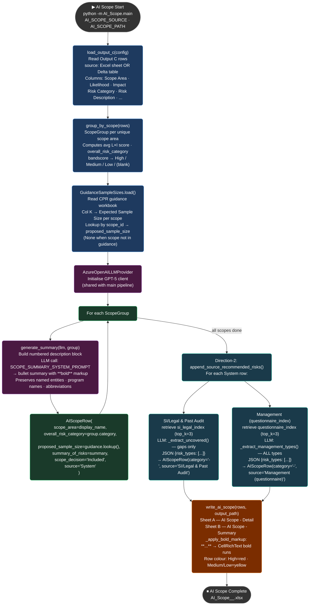
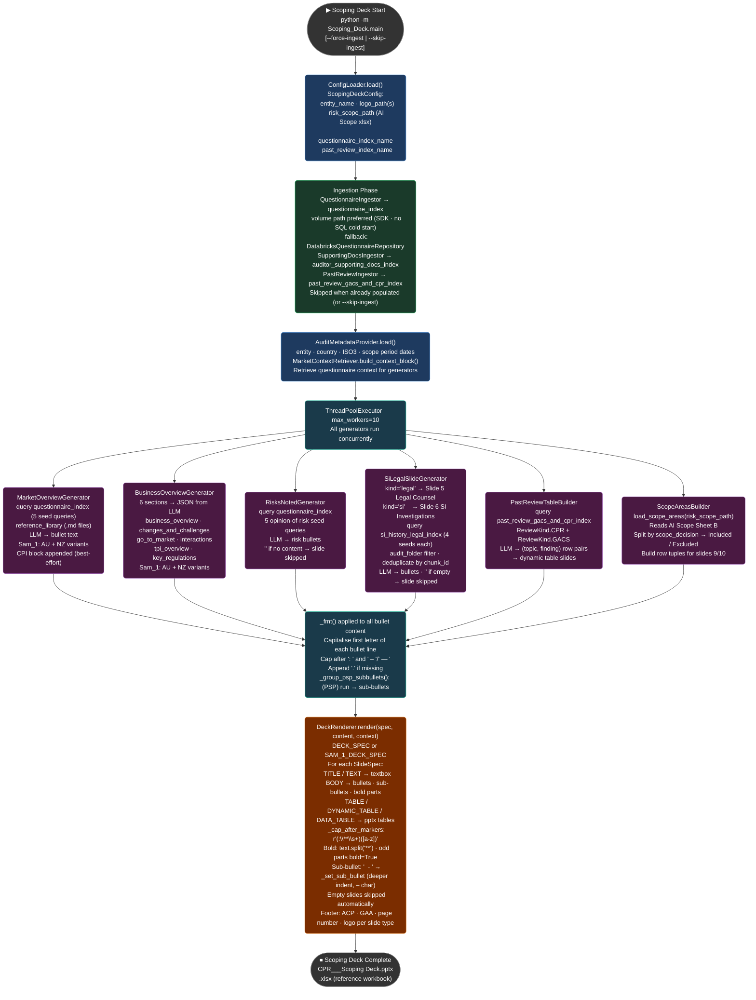

# AI Auditor — Architecture & Flow Diagrams

---

## 0. Current Build — What Changed

- **Phase 0 — ScopeIdentifierAgent** added as the first LangGraph node. Analyses the full question + response + follow-up context and identifies which of the **48 FCPA audit scope areas** apply. Output is a 4-line block: `Primary Scope`, `Additional Scopes`, `Reasoning`, `Confidence`. **Three-tier confidence routing** (in `AuditSupervisor`): `≥ 0.70` use the identified scope(s) as-is; `0.50–0.69` use the identified scope(s) **including any additional scopes** (broader net); `< 0.50` (or no scope after one retry) fall back to **unfiltered retrieval** across all scopes via the `ANY_SCOPE` sentinel — **not** a forced `DUE_DILIGENCE`. Retries once if no scopes are returned.

- **fcpa_scope_policy_index** — Databricks Vector Search index built from `CPR AI - System Guide.xlsx`. **144 chunks** (48 scope areas × 3 chunk types per area): `risk_profile` (cols C+D+E+F+G+H+P — scope desc, red flags, policies, audit steps, name of data, source of data, guidelines), `audit_guidance` (cols F+O), and `sampling_guidance` (cols I+J+K — data calculations, sampling rationale, expected sample size). Ingested via `CPRScopeExtractor`. A dedicated `scripts/reingest_scope_policy_index.py` refreshes it in place (upsert, no delete).

- **PolicyKnowledgeAgent routing** — always calls `retrieve_scope_area_policy(query, scope_id)` against `fcpa_scope_policy_index`; calls `retrieve_due_diligence_policy(query)` against `tpi_due_diligence_index` **only** when identified scope is `DUE_DILIGENCE`. When the injected scope is `ANY_SCOPE`, the scope-policy tool runs **unfiltered** (no `scope_id` filter, widened top-k) so low-confidence questions still retrieve the most relevant guidance across all scopes.

- **BM25Reranker on EvidenceRetrievalTool** — `rank-bm25` BM25Okapi re-ranks a `top_k × 4` semantic candidate pool using RRF fusion: `1/(60+sem_rank) + 1/(60+bm25_rank)`. Corrects semantic ranking misses for exact document names (e.g. `Starters_Leavers_Report_Q3.pdf`).

- **MultiQueryRetriever (MQR)** extended to all retrieval tools: HCBI (n=2 alternatives), Policy (n=2), Evidence (n=3). LLM generates alternative phrasings; results deduplicated by `chunk_id` keeping highest `similarity_score`.

- **Async retrieval everywhere** — `aretrieve()` added to all 4 retrieval tools. `MQR.aretrieve()` uses `asyncio.gather + asyncio.to_thread` for parallel non-blocking searches. Phase A runs all 3 agents fully non-blocking via `asyncio.gather`.

- **Multi-auditor supporting docs** — `auditor_folder` column added to `auditor_supporting_docs_index`. Each auditor's files (e.g. `Sam_1/`, `Kaitlyn_1/`, `Naeem_1/`) ingested into a single shared index, tagged by subfolder name. Retrieval filtered by `AUDITOR_ID` env var at runtime.

- **AUDITOR_ID env var** — replaces the hardcoded `current_auditor_folder` setting. Set once per run (`AUDITOR_ID=Sam_1`); controls which questionnaire rows load and which supporting docs folder is searched.

- **8-agent pipeline** — pipeline now has: `ScopeIdentifierAgent` (Phase 0) → `HcbiPolicyAgent + PolicyKnowledgeAgent + SupportingDocsAgent` (Phase A, parallel) → `RiskEvaluationAgent → TransactionalDataAgent → RiskClassifierAgent → RiskWriterAgent` (Phase B, sequential).

- **Universal guardrails G1–G10** on all 8 agent system prompts: G1–G6 cover hallucination, invented data, bias, FCPA scope, no legal advice, PII protection; G7–G10 cover valid scope IDs, exact output format, no risk assessment in scope agent, confidence calibration.

- **Vector index names (v2)** — `hcbi_policy_index`, `tpi_due_diligence_index`, `auditor_supporting_docs_index`, `fcpa_scope_policy_index`.

- **FastAPI layer** — `/audit` (POST, async pipeline trigger), `/status/{job_id}` (poll result), `/health` (liveness), `/ready` (readiness) endpoints. `X-API-Key` auth middleware. `AuditRequest` / `AuditResponse` Pydantic schemas with full validation.

- **Embedder** — Azure OpenAI `text-embedding-3-large`, **3072 dimensions** (all 4 indexes).

- **Phase 3 — TransactionalDataAnalysisAgent fully redesigned (AI-driven, per-scope).** No hardcoded checks. It iterates **every scope area** (all 48; no scope skipped) and, for each: (1) turns that scope's **Data Calculations** (CPR col I) into SQL — or uses its own FCPA intelligence when the guidance is thin; (2) executes it to get scope-specific computed data; (3) judges a **single consolidated risk assessment**; (4) when a risk is present, pulls samples sized to **Expected Sample Size (CPR col K) + 5 buffer**, forced to `SELECT *` so the full transaction row is captured. **One row per scope** (~48 rows), scopes analysed **concurrently** (thread pool, `_SCOPE_ANALYSIS_WORKERS = 6`). SQL safety: `SELECT`-only, `try_cast` for STRING-typed numeric columns, deterministic `LIMIT` override, exact source table taken from the executed query's `FROM` clause.

- **Risk Category — 6-rule business bifurcation** in the classifier, with two enforced anchors (High ⇒ Potential Risk; No Risk ⇔ No Risk Identified). Risk Type (evidence axis) and Risk Category (severity axis) are **independent**. **Excel row colouring by Risk Category**: High = red, Medium/Low = yellow, No Risk = no fill.

- **New output columns** — `Scope Area Reasoning` (why a scope was assigned) and `Samples` (the pulled transaction rows for a Phase 3 risk). Summary sheet counts resolve columns **by header name** and report only Potential Risk / Further Review Required / No Risk.

- **UI Authentication (SSO)** — access control is handled on the **UI (frontend)**; the whole backend described here is one part of the wider system. Every request is authenticated (SSO) on the UI before it reaches the FastAPI entry. Shown in the architecture as the front-most component for completeness.

- **LLM Layer (shared)** — a single Azure OpenAI initialisation used everywhere: **GPT-5** for chat completions (all 8 agents, Phase 3, MQR query generation) via `AzureOpenAILLMProvider`, and **text-embedding-3-large (3072-dim)** for embeddings (ingestion + all retrieval) via `AzureOpenAIEmbeddingProvider`.

- **Evaluator · Guardrails · Validators (cross-cutting)** — a single governance box spanning the pipeline: prompt guardrails G1–G10, Pydantic schema + structured-output validation, SQL safety (SELECT-only · try_cast · deterministic LIMIT), and output evaluation/quality scoring before a row is written.

- **Persistence on Lakebase Postgres** — two stores: an **Observability Store** capturing traces / spans / metrics / logs from every agent and the pipeline via the **OpenTelemetry (OTEL)** protocol; and a **Feedback Table** holding end-user feedback captured on the UI (rating + comments, keyed to job / question / scope).

- **AI Scope module** (`AI_scope\`) — downstream stage that reads Output C and produces one row per scope area: avg L×I score → risk band, CPR-guided proposed sample size, LLM bullet summary with `**...**` bold markup. Direction-2 appends source-recommended risks from SI/Legal & Past Audit (uncovered types only) and Management questionnaire (all types). Writes Sheet A (detail) + Sheet B (aggregated) to a new Excel workbook. Runs independently as `python -m AI_Scope.main`.

- **Scoping Deck module** (`Scoping_Deck\`) — downstream stage that ingests the questionnaire, SI/Legal KB, and past-review data, then generates a multi-slide PowerPoint scoping deck. Slides include Market Overview, Business Overview, Risks noted by Management, Legal Counsel, SI Investigations, Past Review (CPR + GACS), Areas in Scope, and Areas not in Scope. Spec-driven renderer with bold markup parsing, sub-bullet indentation, and cap-after-colon formatting. Runs independently as `python -m Scoping_Deck.main`.

---

## 1. System Architecture Diagram

```mermaid
flowchart LR

    %% ── UI AUTH ───────────────────────────────────────────────────────────
    subgraph AUTHN["🔐  UI AUTH (SSO)  ·  frontend — backend is one part of the wider system"]
        SSO["UI Authentication (SSO)\nUser login · identity & access control\nGates every request before it reaches the backend"]
    end

    %% ── INPUT LAYER ───────────────────────────────────────────────────────
    subgraph INPUT["📥  INPUT LAYER"]
        direction TB
        subgraph QIN["Questionnaire · Delta Tables"]
            PQ[("Planning Questionnaire")]
            IDR[("IDR Questionnaire\ndata_and_report_request")]
        end
        subgraph DOCS["Policy / Evidence / KB · Databricks Volumes"]
            HCBI[/"HCBI Global Policy\nTV-POL-02257_v3.0.pdf · 115pp · image PDF"/]
            LP[/"TPI Due Diligence Policies\nTPEC · Red Flag · SOP · BGS"/]
            CPR[/"CPR Scope Area Policy\nCPR AI - System Guide.xlsx\n48 scope areas · risk + guidance"/]
            SD[/"Supporting Documents\nauditors_supporting_docs/<auditor_id>/\n.pdf .xls .ppt .pptx .docx .html .msg"/]
            SI_LV[/"SI/Legal Volume\nsi-history-and-legal/<auditor_id>/\nSI investigation reports · legal counsel docs"/]
            PA_LV[/"Past Audit Volume\npast-audit-data/<auditor_id>/\nCPR + GACS past review findings"/]
            QV[/"Questionnaire Volume\nquestionnaire/<auditor_id>/\n.parquet · .json · .csv · .xlsx\n(SDK preferred — no SQL cold start)"/]
        end
        subgraph REF["Reference Files · Volumes"]
            INV[/"TPI Inventory\nMaster TPI Inventory List.xlsx"/]
            GL[/"HCC GL Account Map\nHCC_GL_Account_Map-11142023.xlsx"/]
        end
        subgraph TXN["10 GLD Dashboard Tables · Delta · cpr__gld schema\n7 active (SAM) + 3 additional"]
            TD1[("Disbursement Dashboard")]
            TD2[("Payment Dashboard")]
            TD3[("HCC Dashboard")]
            TD4[("OTC Dashboard")]
            TD5[("Pricing Dashboard")]
            TD6[("Revenue Dashboard")]
            TD7[("Travel & Expense Dashboard")]
            TDEXT[("hcc_full · hcc_attendee\ntravel_expense_attendee\n3 additional — inactive for SAM")]
        end
    end

    %% ── DOCUMENT INTELLIGENCE ─────────────────────────────────────────────
    subgraph DI["🔧  DOCUMENT INTELLIGENCE  ·  async · startup ingestion"]
        direction TB
        UDL["Universal Document Loader\nRoutes by file format · recursive walk\nDocumentType: GLOBAL_POLICY / TPI_POLICY / SUPPORTING_DOC"]
        subgraph EXT["Format Extractors"]
            direction LR
            E1["OCR\nTesseract fallback\nAzure Doc Intelligence"]
            E2["PDF\npdfplumber\nPyMuPDF→OCR"]
            E3["Office/Web/Mail\npython-pptx · python-docx\nopenpyxl · BS4 · extract-msg"]
        end
        CPRX["CPRScopeExtractor\n48-sheet → scope_id mapping\nCols C+D+E+F+G+H+P → risk_profile\nCols F+O → audit_guidance\nCols I+J+K → sampling_guidance\n144 chunks (48×3)"]
        CHK["Section-Aware Chunker\n≤800 tokens · 100-token overlap\nDocumentChunk: scope_id · auditor_folder · source"]
        EMB["Embedder\nAzure OpenAI text-embedding-3-large\n3072 dimensions"]
    end

    %% ── VECTOR STORE — 9 INDEXES ──────────────────────────────────────────
    subgraph VS["🗄️  DATABRICKS VECTOR SEARCH  ·  9 indexes  ·  auditor_folder on all KB indexes"]
        direction TB
        HI[("hcbi_policy_index\nHCBI Global Policy")]
        LPI[("tpi_due_diligence_index\nTPI DD Policies")]
        SDI[("auditor_supporting_docs_index\nEvidence docs · filter by AUDITOR_ID")]
        SPI[("fcpa_scope_policy_index\n144 chunks · 48 scope areas\nrisk_profile + audit_guidance + sampling_guidance")]
        QI[("questionnaire_index\nIDR + Planning Q&A · per auditor\nshared: main pipeline + Scoping Deck")]
        PAI[("past_audit_index\nCPR + GACS past findings · per auditor")]
        SLI[("si_history_legal_index\nSI investigations + legal counsel · per auditor")]
        TXAI[("transactional_analysis_index\nPhase 3 findings · per auditor\npersisted after Phase 3 · used for Aggregation")]
        RAWTI[("raw_transactional_tables_index\n10 dashboard table schemas · per auditor\npersisted after Phase 3")]
    end

    %% ── FASTAPI ───────────────────────────────────────────────────────────
    subgraph API["🌐  FASTAPI  ·  async"]
        EP1["POST /audit\nAuditRequest → job_id"]
        EP2["GET /status/{job_id}\nAuditResponse"]
        EP3["GET /health · /ready"]
        AUTH["X-API-Key middleware\n401 · sanitize · 10 req/min"]
    end

    %% ── PHASE 3 — RUNS FIRST ─────────────────────────────────────────────
    subgraph P3["🔎  PHASE 3  ·  TransactionalDataAnalysisAgent  ·  *** RUNS FIRST — before question loop ***  ·  48 scopes · 6 workers concurrent"]
        direction TB
        P3G["Load CPR guidance ALL 48 scopes\nrisk_profile · red_flags · data_calcs\nsampling_rationale · expected_sample_size"]
        P3C["Step 1&2 per scope:\nLLM turns Data Calculations → SQL\nor FCPA intelligence when guidance thin\nExecute → scope computed data · try_cast · LIMIT 25"]
        P3J["Step 3 per scope:\nLLM judges ONE consolidated assessment\nRisk Type · Category · Description · Rationale"]
        P3S["Step 4 if risk:\nSELECT * samples\nLIMIT = col K + 5 · exact FROM table"]
        P3R["~48 RiskOutput rows (one per scope)\nNo Risk scopes: row with no samples"]
    end

    TXCTX["transactional_context\nformat_transactional_context(Phase 3 findings)\ninjected into EVERY question supervisor"]
    RECCTX["recurrence_context\n_build_recurrence_context()\nqueries past_audit_index + si_history_legal_index\ninjected into EVERY question supervisor"]

    %% ── LANGGRAPH 8-AGENT PIPELINE ────────────────────────────────────────
    subgraph GRAPH["🤖  LANGGRAPH 8-AGENT PIPELINE  ·  per question  ·  QUESTION_CONCURRENCY concurrent  ·  async  ·  mode=scope-after-analysis"]
        direction TB
        subgraph PA["Phase A — Parallel Retrieval  ·  asyncio.gather()  ·  UNFILTERED (no scope pre-filter)"]
            direction LR
            subgraph HPA_G["HCBI Agent"]
                MQR_H["MQR n=2"]
                HPA["HcbiPolicyAgent\nhcbi_policy_index · top-k=5"]
            end
            subgraph PKA_G["Policy Knowledge Agent"]
                PKA["PolicyKnowledgeAgent\nTool 1: fcpa_scope_policy_index · unfiltered wide top-k\nTool 2 DUE_DILIGENCE: tpi_due_diligence_index · top-k=5\nMQR n=2"]
            end
            subgraph EAA_G["Supporting Docs Agent"]
                MQR_E["MQR n=3"]
                BM25["BM25Reranker · RRF fusion\n1/(60+sem)+1/(60+bm25) · pool=top_k×4"]
                EAA["SupportingDocsAgent\nauditor_supporting_docs_index\naudit_folder=AUDITOR_ID · top-k=5"]
            end
        end
        subgraph PB["Phase B — Sequential Analysis"]
            direction TB
            CD["Conflict Detector\nInMemoryStore · threshold 0.90 + response divergence\n→ Further Review Required flag"]
            REA["RiskEvaluationAgent  GPT-5\ncompliance gaps · impact · transactional_intent flag"]
            TDA["TransactionalDataAgent  CONDITIONAL\nNL-to-SQL · 7 active dashboard tables"]
            RCA["RiskClassifierAgent  GPT-5\n9-field: Risk Type · Category · Evidence Verdict\nPattern/Scenario Match · Policy Req · Evidence Gap · GL Mismatch · Scope"]
        end
        subgraph PSCOPE["Scope Tagging — POST-ANALYSIS  ·  after risk is identified"]
            SIA["ScopeIdentifierAgent  GPT-5\nInput: question + risk_eval + classification\nCategorises the IDENTIFIED RISK into FCPA scope area(s)\nOutput: Primary Scope · Additional Scopes · Confidence\nRetry once if empty · Multi-scope only when confident\n≥HIGH confidence → additional scopes included\n<MODERATE → Scope Unclear — Manual Review Required"]
        end
        subgraph PWRITE["Writer"]
            RWA["RiskWriterAgent  GPT-5\nInput: classifier output + ASSIGNED FCPA SCOPE(S)\nRisk Title/Type/Category+reasoning/Rationale/Description\nScope Area+reasoning · Doc Ref · Summary\nIncremental Excel save per question"]
        end
    end

    %% ── AGGREGATION STAGE ─────────────────────────────────────────────────
    subgraph AGGR["📊  AGGREGATION STAGE  ·  after all questions  ·  RiskAggregationAgent"]
        AGGRA["RiskAggregationAgent  GPT-5\nClusters per-question + Phase 3 rows → unique risks\nSets Past Occurrence via past_audit KB\nRolls up per scope → scope_overall"]
        OUTC[("Output C — AI Risk Analysis\naggregated unique risks · one row per distinct risk\nread by AI Scope module")]
    end

    %% ── PAST AUDIT STAGE ──────────────────────────────────────────────────
    subgraph PASTAUDIT["📋  PAST AUDIT STAGE  ·  PastAuditSummarizerAgent"]
        PASTA["PastAuditSummarizerAgent  GPT-5\nqueries past_audit_index · one row per observation"]
    end

    %% ── OUTPUT ────────────────────────────────────────────────────────────
    subgraph OUTPUT["📤  OUTPUT  ·  FCPA_Audit_<AUDITOR_ID>_<timestamp>.xlsx"]
        direction TB
        OUTXL[("Output A — Risk Detail\nper question rows + Phase 3 rows\nRow colour: High=red · Med/Low=yellow · No Risk=none\nOutput B — Scope Summary\nPotential Risk · FRR · No Risk counts")]
        OUTF[("Output F — Scope Txn Summary\nper scope: txn count + local/USD totals\nFX per transaction date · Frankfurter ECB")]
        OUTPA[("Past Audit Report sheet\none row per past observation")]
    end

    %% ── AI SCOPE ──────────────────────────────────────────────────────────
    subgraph AISCOPE["🔬  AI SCOPE  ·  AI_scope\\  ·  python -m AI_Scope.main  ·  standalone"]
        direction TB
        ASC["load_output_c() · group_by_scope()\navg L×I → overall_risk_category (High/Med/Low)"]
        ASG["generate_summary(llm, group)\nLLM: SCOPE_SUMMARY_SYSTEM_PROMPT\nbullet summary · **bold** markup · preserves named entities"]
        ASD2["Direction-2: append_source_recommended_risks()\nSI/Legal + Past Audit → uncovered risk types only\nManagement (questionnaire) → ALL risk types\n→ extra AIScopeRow per type (category='-')"]
        ASW["write_ai_scope(rows)\nSheet A: AI Scope - Detail (one row per AIScopeRow)\nSheet B: AI Scope - Summary (aggregated per scope)\n**...** → CellRichText bold · row colour by risk band"]
    end

    %% ── SCOPING DECK ──────────────────────────────────────────────────────
    subgraph SCDECK["📊  SCOPING DECK  ·  Scoping_Deck\\  ·  python -m Scoping_Deck.main  ·  standalone"]
        direction TB
        SDI2["Ingestion (SDK · volume path preferred)\nQuestionnaireIngestor → questionnaire_index\nSupportingDocsIngestor · PastReviewIngestor"]
        SDG["ThreadPoolExecutor 10 workers — concurrent generators:\nMarketOverviewGenerator · BusinessOverviewGenerator\nRisksNotedGenerator · SiLegalSlideGenerator(legal+si)\nPastReviewTableBuilder(CPR+GACS) · ScopeAreasBuilder(AI Scope Sheet B)"]
        SDR["DeckRenderer · DECK_SPEC / SAM_1_DECK_SPEC driven\n**bold** → font.bold · sub-bullets · _CAP_COLON r'(:\\**\\s+)([a-z])'\nempty slides skipped · logo + footer per slide type"]
        SDO[("CPR_Entity_Period_Scoping Deck.pptx\n+ reference .xlsx workbook")]
    end

    %% ── LLM LAYER (SHARED) ────────────────────────────────────────────────
    subgraph LLML["🧠  LLM LAYER  ·  Azure OpenAI  ·  initialised once · shared"]
        LLM_CHAT["Azure OpenAI GPT-5  ·  AzureOpenAILLMProvider\nall 8 agents · Phase 3 · MQR · Aggregation · Past Audit · AI Scope · Scoping Deck"]
        LLM_EMB["text-embedding-3-large · 3072-dim  ·  AzureOpenAIEmbeddingProvider\nEmbedder (ingestion) + all vector retrieval"]
    end

    %% ── GOVERNANCE ────────────────────────────────────────────────────────
    subgraph GOV["🛡️  EVALUATOR · GUARDRAILS · VALIDATORS  ·  cross-cutting"]
        GV["G1–G10 on all agent prompts · Pydantic schema + structured-output validation\nSQL safety: SELECT-only · try_cast · deterministic LIMIT · output quality scoring"]
    end

    %% ── PERSISTENCE ───────────────────────────────────────────────────────
    subgraph PERSIST["🗃️  PERSISTENCE  ·  Lakebase Postgres"]
        OTEL[("Observability Store (OTEL)\ntraces · spans · metrics · logs\nevery agent + pipeline")]
        FB[("Feedback Table\nend-user rating + comments\nkeyed to job / question / scope")]
    end

    TB["⚙️  Python · LangChain · LangGraph · Azure OpenAI GPT-5 · text-embedding-3-large 3072-dim · Databricks Vector Search · Delta Lake · Databricks SDK (WorkspaceClient) · Lakebase Postgres · OpenTelemetry · asyncio · rank-bm25 · SQLAlchemy · FastAPI · pydantic-settings · openpyxl · pdfplumber · PyMuPDF · python-pptx · Tesseract OCR"]

    %% ── CONNECTIONS ───────────────────────────────────────────────────────

    %% Policy/evidence docs → DI → indexes
    HCBI & LP --> UDL
    SD --> UDL
    CPR --> CPRX
    UDL --> EXT --> CHK --> EMB
    CPRX --> SPI
    EMB -->|"GLOBAL_POLICY chunks"| HI
    EMB -->|"TPI_POLICY chunks"| LPI
    EMB -->|"SUPPORTING_DOC chunks tagged auditor_folder"| SDI

    %% KB volume ingestion → indexes (startup · SDK · no SQL cold start)
    SI_LV -->|"SDK startup ingestion"| SLI
    PA_LV -->|"SDK startup ingestion"| PAI
    QV -->|"SDK startup · no SQL cold start"| QI
    PQ & IDR -.->|"fallback when volume empty"| QI

    %% FastAPI
    SSO -->|"authenticated request"| EP1
    EP1 & EP2 & EP3 --> AUTH
    AUTH -->|"triggers pipeline"| GRAPH

    %% Phase 3 RUNS FIRST (before question loop)
    SPI -->|"CPR guidance · all 48 scopes"| P3G
    P3G --> P3C
    TD1 & TD2 & TD3 & TD4 & TD5 & TD6 & TD7 -->|"Data Calcs SQL + samples"| P3C
    P3C --> P3J --> P3S --> P3R
    P3R -->|"_persist_transactional_index"| TXAI
    TD1 & TD2 & TD3 & TD4 & TD5 & TD6 & TD7 -->|"pull_table_info schemas"| RAWTI
    P3R -->|"format_transactional_context()"| TXCTX
    PAI & SLI -->|"_build_recurrence_context()"| RECCTX
    TXCTX & RECCTX -->|"injected into every question supervisor"| GRAPH

    %% Question loop — Phase A (unfiltered) → B → Scope tagging → Writer
    PQ & IDR -->|"question + response + follow-up"| PA
    MQR_H --> HPA
    HPA <-->|"async semantic search"| HI
    PKA <-->|"async · unfiltered"| SPI
    PKA <-->|"DUE_DILIGENCE only"| LPI
    MQR_E --> EAA
    EAA <-->|"async · auditor_folder filter"| SDI
    EAA --> BM25
    PA -->|"HCBI + policy + evidence context"| PB
    CD --> REA --> TDA
    TD1 & TD2 & TD3 & TD4 & TD5 & TD6 & TD7 -->|"SQL conditional"| TDA
    TDA --> RCA
    RCA -->|"risk_eval + classification"| SIA
    SIA -->|"ASSIGNED FCPA SCOPE(S)"| RWA
    RWA --> OUTXL

    %% Aggregation → Output C
    OUTXL -->|"completed_states + analysis_findings"| AGGRA
    TXAI & PAI -->|"Past Occurrence lookup"| AGGRA
    AGGRA --> OUTC

    %% Output F and Past Audit
    P3R -->|"build_scope_transaction_summary()"| OUTF
    PAI -->|"past_audit_index"| PASTA
    PASTA --> OUTPA

    %% AI Scope (reads Output C)
    OUTC -->|"Output C aggregated risks"| ASC
    ASC --> ASG --> ASD2
    SLI & PAI -->|"Direction-2 uncovered"| ASD2
    QI -->|"Direction-2 management all"| ASD2
    ASD2 --> ASW

    %% Scoping Deck (reads AI Scope + indexes)
    ASW -->|"AI Scope Sheet B"| SDI2
    QI & SLI & PAI -->|"KB indexes"| SDI2
    SDI2 --> SDG --> SDR --> SDO

    %% LLM shared (dotted)
    LLM_EMB -.->|"embeddings"| EMB
    LLM_EMB -.->|"query embeddings"| VS
    LLM_CHAT -.->|"GPT-5"| GRAPH
    LLM_CHAT -.->|"GPT-5"| P3
    LLM_CHAT -.->|"GPT-5"| AGGR
    LLM_CHAT -.->|"GPT-5"| PASTAUDIT
    LLM_CHAT -.->|"GPT-5"| AISCOPE
    LLM_CHAT -.->|"GPT-5"| SCDECK

    %% Governance (dotted)
    GV -.->|"guardrails + validation"| GRAPH
    GV -.->|"guardrails + validation"| P3
    GV -.->|"quality scoring"| OUTPUT

    %% Persistence (dotted)
    GRAPH -.->|"OTEL traces"| OTEL
    P3 -.->|"OTEL traces"| OTEL
    API -.->|"OTEL traces"| OTEL
    OUTPUT -.->|"end-user review"| FB
    SSO -.->|"feedback via UI"| FB

    OUTXL ~~~ TB

    %% ── STYLES ────────────────────────────────────────────────────────────
    classDef inputStyle  fill:#1e3a5f,stroke:#4a90d9,color:#fff
    classDef refStyle    fill:#1a2a4a,stroke:#6ab0f5,color:#fff
    classDef diStyle     fill:#1a3a2a,stroke:#2ecc71,color:#fff
    classDef vsStyle     fill:#0d3b6e,stroke:#3498db,color:#fff
    classDef kbStyle     fill:#1a2a5a,stroke:#6ab0f5,color:#fff
    classDef scopeStyle  fill:#3a1a5f,stroke:#9b59b6,color:#fff
    classDef agentStyle  fill:#2d4a1e,stroke:#27ae60,color:#fff
    classDef mqrStyle    fill:#1a3a3a,stroke:#1abc9c,color:#fff
    classDef bm25Style   fill:#4a3500,stroke:#e67e22,color:#fff
    classDef condStyle   fill:#4a2000,stroke:#e67e22,color:#fff
    classDef riskEval    fill:#2d1942,stroke:#9b59b6,color:#fff
    classDef classStyle  fill:#1a2a4a,stroke:#3498db,color:#fff
    classDef writerStyle fill:#1a3a1a,stroke:#27ae60,color:#fff
    classDef phase3Style fill:#1a3a3a,stroke:#1abc9c,color:#fff
    classDef ctxStyle    fill:#0a3a3a,stroke:#1abc9c,color:#fff
    classDef outputStyle fill:#7b2d00,stroke:#e67e22,color:#fff
    classDef aggrStyle   fill:#3a2a1a,stroke:#f39c12,color:#fff
    classDef apiStyle    fill:#2a1a3a,stroke:#8e44ad,color:#fff
    classDef authStyle   fill:#3a2a00,stroke:#f1c40f,color:#fff
    classDef llmStyle    fill:#0a2540,stroke:#00b4d8,color:#fff
    classDef govStyle    fill:#4a1420,stroke:#e74c3c,color:#fff
    classDef persStyle   fill:#14322a,stroke:#16a085,color:#fff
    classDef aiScopeStyle fill:#2a1a4a,stroke:#a78bfa,color:#fff
    classDef deckStyle   fill:#1a3a4a,stroke:#38bdf8,color:#fff
    classDef techBar     fill:#1a1a1a,stroke:#555,color:#aaa

    class PQ,IDR,HCBI,LP,CPR,SD,SI_LV,PA_LV,QV,TD1,TD2,TD3,TD4,TD5,TD6,TD7,TDEXT inputStyle
    class INV,GL refStyle
    class UDL,CHK,EMB,E1,E2,E3,CPRX diStyle
    class HI,LPI,SDI,SPI vsStyle
    class QI,PAI,SLI,TXAI,RAWTI kbStyle
    class SIA scopeStyle
    class HPA,PKA,EAA,CD,PASTA agentStyle
    class MQR_H,MQR_E mqrStyle
    class BM25 bm25Style
    class TDA condStyle
    class REA riskEval
    class RCA classStyle
    class RWA writerStyle
    class P3G,P3C,P3J,P3S,P3R phase3Style
    class TXCTX,RECCTX ctxStyle
    class OUTXL,OUTF,OUTPA outputStyle
    class AGGRA,OUTC aggrStyle
    class EP1,EP2,EP3,AUTH apiStyle
    class SSO authStyle
    class LLM_CHAT,LLM_EMB llmStyle
    class GV govStyle
    class OTEL,FB persStyle
    class ASC,ASG,ASD2,ASW aiScopeStyle
    class SDI2,SDG,SDR,SDO deckStyle
    class TB techBar
```

---

## 2. Data Flow — Single Question Row (Phase A → B → Scope → Writer)

```mermaid
flowchart TD

    START(["▶ Start\nRead one question row\nAUDITOR_ID env · transactional_context + recurrence_context pre-loaded"])

    STEP_A["Phase A — Parallel Retrieval  ─  asyncio.gather()  ─  UNFILTERED (scope not used to pre-filter)"]

    STEP_A1["HcbiPolicyAgent\nMQR n=2 alternatives → LLM.ainvoke()\nasyncio.gather → hcbi_policy_index\ntop-k=5 · Dedup by chunk_id"]

    STEP_A2["PolicyKnowledgeAgent\nTool 1 (always):\n  fcpa_scope_policy_index · unfiltered wide top-k\n  risk_profile + audit_guidance chunks\nTool 2 (DUE_DILIGENCE only):\n  MQR n=2 → tpi_due_diligence_index · top-k=5"]

    STEP_A3["SupportingDocsAgent\nMQR n=3 alternatives → LLM.ainvoke()\nCandidate pool = top-k × 4\nauditor_supporting_docs_index\naudit_folder = AUDITOR_ID\nBM25Reranker: RRF = 1/(60+sem) + 1/(60+bm25)"]

    STEP_CD["Conflict Detector\nEmbed question · compare vs InMemoryStore (all prior rows)\nSimilarity > 0.90 + response divergence\n→ conflict_flag = Further Review Required"]

    STEP_B1["RISK EVALUATION AGENT  ─  GPT-5\nInput: HCBI + policy + evidence context\n  + transactional_context (Phase 3 pre-loaded)\n  + recurrence_context (past_audit + si_legal)\n  + conflict_flag\nIdentifies compliance gaps · impact · transactional_intent flag"]

    TXND{"Transactional intent\n+ quantitative signal\nin response?"}

    STEP_TDA["Transactional Data Agent  ─  NL-to-SQL  CONDITIONAL\nSQL against 10 GLD dashboard tables (7 active for SAM)\nReturns calculated quantitative result"]

    STEP_B2["RISK CLASSIFIER AGENT  ─  GPT-5\n9-field block:\n• Risk Type · Risk Category · Evidence Verdict\n• Pattern Match · Scenario Match\n• Key Policy Req · Key Evidence Gap\n• GL Mismatch · Scope Determination"]

    STEP_SCOPE["SCOPE TAGGING — POST-ANALYSIS  ─  ScopeIdentifierAgent  ─  GPT-5\nInput: question + risk_eval + classification\nCategorises the IDENTIFIED RISK into FCPA scope area(s)\nOutput: Primary Scope · Additional Scopes · Confidence\n≥HIGH conf → include additional scopes\n<MODERATE → Scope Unclear — Manual Review Required\nRetry once if no scope returned"]

    STEP_B3["RISK WRITER AGENT  ─  GPT-5\nInput: classifier output + ASSIGNED FCPA SCOPE(S)\n• Risk Title / Type / Category (+reasoning)\n• Risk Description · Risk Rationale\n• Scope Area · Scope Area Reasoning\n• Document Reference · Risk Summary\nIncremental Excel save after each question"]

    NEXTROW{"More rows?"}
    NOTE_P3(["Note: Phase 3 (TransactionalDataAnalysisAgent)\nalready ran BEFORE this loop\n~48 rows · one per FCPA scope area"])
    END(["⏹ Complete → Aggregation → Output C\nFCPA_Audit_<AUDITOR_ID>_<ts>.xlsx"])

    START --> STEP_A
    STEP_A --> STEP_A1 & STEP_A2 & STEP_A3
    STEP_A1 & STEP_A2 & STEP_A3 --> STEP_CD --> STEP_B1
    STEP_B1 --> TXND
    TXND -->|"Yes"| STEP_TDA --> STEP_B2
    TXND -->|"No"| STEP_B2
    STEP_B2 --> STEP_SCOPE --> STEP_B3 --> NEXTROW
    NEXTROW -->|"Yes"| START
    NEXTROW -->|"No"| END

    NOTE_P3 -.-> START

    classDef phaseA   fill:#1a4731,stroke:#2ecc71,color:#fff,rx:6
    classDef cd       fill:#2d4a1e,stroke:#27ae60,color:#fff,rx:6
    classDef riskEval fill:#2d1942,stroke:#9b59b6,color:#fff,rx:6
    classDef classif  fill:#1a2a4a,stroke:#3498db,color:#fff,rx:6
    classDef scopeTag fill:#3a1a5f,stroke:#9b59b6,color:#fff,rx:6
    classDef writer   fill:#1a3a1a,stroke:#27ae60,color:#fff,rx:6
    classDef cond     fill:#4a2000,stroke:#e67e22,color:#fff
    classDef terminal fill:#333,stroke:#888,color:#fff,rx:20
    classDef decision fill:#7b4f00,stroke:#e67e22,color:#fff
    classDef note     fill:#1a3a3a,stroke:#1abc9c,color:#fff,rx:20

    class STEP_A,STEP_A1,STEP_A2,STEP_A3 phaseA
    class STEP_CD cd
    class STEP_B1 riskEval
    class STEP_B2 classif
    class STEP_SCOPE scopeTag
    class STEP_B3 writer
    class TXND,NEXTROW decision
    class STEP_TDA cond
    class START,END terminal
    class NOTE_P3 note
```



---

## 3. Data Flow — Phase 3 (TransactionalDataAnalysisAgent)

```mermaid
flowchart TD

    P3START(["▶ Phase 3 Start\nRuns ONCE per audit (after all question rows)\nAI-driven · guided by CPR · one row per scope"])

    LOAD["Load CPR guidance for ALL 48 scopes\n(_load_all_cpr_guidance — single pass)\nrisk profile · red flags · data calculations\nsampling rationale · expected sample size\nNo scope skipped (empty calcs → use AI intelligence)"]

    SUMM["Pull shared transactional data summary ONCE\npayments · revenue · credit-memo (schema + top aggregates)\nColumn types (DESCRIBE) passed to the model"]

    POOL{{"Thread pool · 6 concurrent workers\nfor each of the 48 scopes ↓"}}

    S1["Step 1 — Generate calc SQL (LLM)\nTurn that scope's Data Calculations (col I) into SQL\nor use FCPA intelligence when guidance is thin\ntry_cast for STRING numerics · LIMIT 25 cap"]

    S2["Step 2 — Execute calculations\nRun the SQL → scope-specific computed data\n(falls back to shared summary if none produced)"]

    S3["Step 3 — Judge risk (LLM)\nONE consolidated assessment for the scope:\nRisk Type · Risk Category · Score\nDescription (all concerns merged) · Rationale"]

    DEC{"Actual risk?\n(Potential / Further Review)"}

    S4["Step 4 — Pull samples\nSELECT * (full row) · ORDER BY prioritised\nLIMIT = Expected Sample Size (col K) + 5\nExact source table from FROM clause"]

    ROW["One RiskOutput row for the scope\nscope_area = real scope id\nNo Risk scopes → row with no samples"]

    MERGE["Aggregate ~48 per-scope rows\n(order preserved via pool.map)"]

    OW["Output Writer\nAppend Phase 3 rows after questionnaire rows\nRow colour by Risk Category · rebuild Output B summary\nIncremental Excel save"]

    END(["⏹ Phase 3 Complete"])

    P3START --> LOAD --> SUMM --> POOL --> S1 --> S2 --> S3 --> DEC
    DEC -->|"Yes"| S4 --> ROW
    DEC -->|"No"| ROW
    ROW --> MERGE --> OW --> END

    classDef stepStyle  fill:#1a3a3a,stroke:#1abc9c,color:#fff,rx:6
    classDef llmStyle   fill:#4a1942,stroke:#9b59b6,color:#fff,rx:6
    classDef ioStyle    fill:#1e3a5f,stroke:#4a90d9,color:#fff,rx:6
    classDef decision   fill:#7b4f00,stroke:#e67e22,color:#fff
    classDef terminal   fill:#333,stroke:#888,color:#fff,rx:20

    class LOAD,SUMM,S2,ROW stepStyle
    class S1,S3 llmStyle
    class S4,MERGE,OW ioStyle
    class DEC,POOL decision
    class P3START,END terminal
```



---

## 4. ASCII Architecture (Quick Reference)

```
┌──────────────────────────────────────────────────────────────────────────────────────┐
│  UI AUTHENTICATION (SSO)   ·  frontend — this backend is one part of the wider system │
│  User login · identity & access control · every request authenticated before backend  │
└──────────────────────────────────────────┬────────────────────────────────────────────┘
                                           │ authenticated request → FastAPI /audit
                                           ▼
┌──────────────────────────────────────────────────────────────────────────────────────┐
│  INPUT LAYER                                                                          │
│                                                                                       │
│  ┌───────────────────────┐   ┌──────────────────────────────────────────────────────┐│
│  │  Questionnaire Data   │   │  Policy & Evidence Documents (Databricks Volumes)    ││
│  │  (Delta Tables)       │   │                                                      ││
│  │  • Planning Q&A       │   │  • HCBI PDF (image-based, 115pp)  ── GLOBAL_POLICY   ││
│  │  • IDR Q&A            │   │  • TPI Due Diligence Policies     ── TPI_POLICY      ││
│  │    (data_and_report   │   │  • CPR Scope Policy Excel (48 scopes, 144 chunks)    ││
│  │     _request)         │   │  • Supporting Docs (auditors_supporting_documents/)  ││
│  │  • follow-up Q&A      │   │    Sam_1/ · Kaitlyn_1/ · Naeem_1/ ...  SUPPORTING   ││
│  ├───────────────────────┤   └──────────────────────────────────────────────────────┘│
│  │  Transactional Data   │   ┌──────────────────────────────────────────────────────┐│
│  │  (Delta Tables)       │   │  Reference Files (Databricks Volumes)                ││
│  │  • Payments Summary   │   │  • TPI_Inventory_Final_Output.xlsx                   ││
│  │  • Credit Memo        │   │  • HCC_GL_Account_Map-11142023.xlsx                  ││
│  │  • Revenue Summary    │   └──────────────────────────────────────────────────────┘│
│  └───────────────────────┘                                                            │
└──────────────────────────────────────────┬────────────────────────────────────────────┘
                                           │
                                           ▼
┌──────────────────────────────────────────────────────────────────────────────────────┐
│  DOCUMENT INTELLIGENCE  (async · startup ingestion · once per index)                  │
│                                                                                       │
│  Universal Document Loader  →  Format Extractors                                      │
│  (routes by DocumentType)       PDF: pdfplumber + PyMuPDF → Azure Doc Intelligence   │
│                                 Office: python-pptx · python-docx · openpyxl         │
│                                 Web/Mail: BeautifulSoup · extract-msg                 │
│       ↓                                                                               │
│  Section-Aware Chunker (≤800 tokens, 100-token overlap)                              │
│  DocumentChunk: chunk_id · scope_id · auditor_folder · source · content · metadata   │
│       ↓                   ↓                      ↓                     ↓             │
│  hcbi_policy_index   tpi_due_diligence_index  auditor_supporting   fcpa_scope_       │
│  (HCBI Global)       (TPI DD Policies)        _docs_index          policy_index      │
│                                               (auditor_folder tag) (144 CPR chunks)  │
│  ────────── All 4 indexes: auditor_folder column · text-embedding-3-large · 3072 dims│
└──────────────────────────────────────────┬────────────────────────────────────────────┘
                                           │ per question row · AUDITOR_ID=Sam_1
                                           ▼
┌──────────────────────────────────────────────────────────────────────────────────────┐
│  PHASE 0 — ScopeIdentifierAgent                                                       │
│                                                                                       │
│  Input: question + response + follow-up context                                       │
│  LLM analyses against 48 FCPA audit scope area descriptions                          │
│  Output (4-line block):                                                               │
│    Primary Scope:      EXACT_SCOPE_ID                                                 │
│    Additional Scopes:  SCOPE_ID, SCOPE_ID / None                                      │
│    Reasoning:          one sentence                                                   │
│    Confidence:         0.0 – 1.0                                                      │
│                                                                                       │
│  → Retry once if no scopes returned                                                   │
│  → Three-tier routing:  ≥0.70 scope(s) · 0.50–0.69 scope(s)+additional               │
│                         <0.50 or none → ANY_SCOPE (unfiltered retrieval)             │
│  → Result appended to base_msg: IDENTIFIED FCPA SCOPE(S): <label>                    │
└──────────────────────────────────────────┬────────────────────────────────────────────┘
                                           │
                                           ▼
┌──────────────────────────────────────────────────────────────────────────────────────┐
│  PHASE A — PARALLEL RETRIEVAL  (asyncio.gather · UNFILTERED — no scope pre-filter)   │
│                                                                                       │
│  ┌───────────────────────┐  ┌──────────────────────────┐  ┌──────────────────────┐  │
│  │  HcbiPolicyAgent      │  │  PolicyKnowledgeAgent     │  │  SupportingDocsAgent │  │
│  │                       │  │                           │  │                      │  │
│  │  MQR n=2 alternatives │  │  Tool 1 (always):         │  │  MQR n=3 alternatives│  │
│  │  asyncio.gather       │  │  fcpa_scope_policy_index  │  │  asyncio.gather      │  │
│  │  ↕ hcbi_policy_index  │  │  unfiltered · wide top-k  │  │  candidate_k=top_k×4 │  │
│  │  top-5 chunks         │  │                           │  │  ↕ auditor_supporting│  │
│  │                       │  │  Tool 2 (DUE_DILIGENCE):  │  │    _docs_index        │  │
│  │  Dedup by chunk_id    │  │  tpi_due_diligence_index  │  │  filter: auditor_    │  │
│  │  keep best score      │  │  MQR n=2 · top-5 chunks   │  │  folder = AUDITOR_ID │  │
│  │                       │  │                           │  │                      │  │
│  │                       │  │                           │  │  BM25Reranker:       │  │
│  │                       │  │                           │  │  RRF fusion          │  │
│  │                       │  │                           │  │  1/(60+sem_rank)     │  │
│  │                       │  │                           │  │  + 1/(60+bm25_rank)  │  │
│  └───────────────────────┘  └──────────────────────────┘  └──────────────────────┘  │
└──────────────────────────────────────────┬────────────────────────────────────────────┘
                                           │
                                           ▼
┌──────────────────────────────────────────────────────────────────────────────────────┐
│  PHASE B — SEQUENTIAL ANALYSIS                                                        │
│                                                                                       │
│  ┌─────────────────────────────────────────────────────────────────────────────┐     │
│  │  Conflict Detector — cross-row semantic similarity via InMemoryStore         │     │
│  │  similarity > 0.90 + response divergence → Further Review Required flag      │     │
│  └───────────────────────────────┬─────────────────────────────────────────────┘     │
│                                  ↓                                                    │
│  ┌─────────────────────────────────────────────────────────────────────────────┐     │
│  │  RISK EVALUATION AGENT — GPT-5                                                │     │
│  │  Input: HCBI + policy + evidence context + transactional_context              │     │
│  │        + recurrence_context + conflict_flag                                   │     │
│  │  Identifies compliance gaps · Assesses impact · Sets transactional_intent     │     │
│  └──────────────────┬──────────────────────────────────────────────────────────┘     │
│                     │ transactional_intent=true + quantitative signal in response     │
│                     ↓                                                                 │
│  Transactional Data Agent (CONDITIONAL) — NL-to-SQL against 10 dashboard tables      │
│                     ↓                                                                 │
│  ┌─────────────────────────────────────────────────────────────────────────────┐     │
│  │  RISK CLASSIFIER AGENT — GPT-5                                                │     │
│  │  9-field classification: Risk Type · Evidence Verdict · Pattern Match         │     │
│  │  Key Policy Req · Key Evidence Gap · GL Mismatch · Scope Determination        │     │
│  └───────────────────────────────┬─────────────────────────────────────────────┘     │
│                                  ↓                                                    │
│  SCOPE TAGGING — POST-ANALYSIS  (ScopeIdentifierAgent — runs AFTER risk identified)  │
│  Input: question + risk_eval + classification                                         │
│  Output: Primary Scope · Additional Scopes · Confidence                              │
│  ≥HIGH confidence → additional scopes · <MODERATE → Scope Unclear — Manual Review    │
│                                  ↓                                                    │
│  ┌─────────────────────────────────────────────────────────────────────────────┐     │
│  │  RISK WRITER AGENT — GPT-5                                                    │     │
│  │  Input: classifier output + ASSIGNED FCPA SCOPE(S)                            │     │
│  │  Risk Title / Type / Category (+reasoning) / Rationale / Description          │     │
│  │  Scope Area + reasoning · Document Reference · Summary                        │     │
│  │  Incremental Excel save after each question                                   │     │
│  └─────────────────────────────────────────────────────────────────────────────┘     │
└──────────────────────────────────────────┬────────────────────────────────────────────┘
                                           │ after all rows
                                           ▼
┌──────────────────────────────────────────────────────────────────────────────────────┐
│  PHASE 3 — TransactionalDataAnalysisAgent  *** RUNS FIRST — before question loop ***  │
│                                                                                       │
│  Load CPR guidance for ALL 48 scopes · pull shared data summary once                 │
│  Analyse scopes CONCURRENTLY (thread pool · 6 workers) — one row per scope:          │
│    1. LLM turns the scope's Data Calculations (col I) into SQL                        │
│       (or uses FCPA intelligence when guidance is thin) · try_cast · LIMIT 25         │
│    2. Execute → scope-specific computed data                                          │
│    3. LLM judges ONE consolidated assessment (Risk Type · Category · Desc · Rationale)│
│    4. If actual risk → SELECT * samples · LIMIT = Expected Sample Size (col K) + 5    │
│       exact source table taken from the query FROM clause                             │
│                                                                                       │
│  After Phase 3:                                                                       │
│    • _persist_transactional_index  → transactional_analysis_index  (findings indexed) │
│    • _persist_raw_tables_index     → raw_transactional_tables_index (table schemas)   │
│    • format_transactional_context() → transactional_context  ─┐                      │
│    • _build_recurrence_context()   → recurrence_context       ├→ injected into every │
│      (queries past_audit + si_legal indexes)                  ┘   question's supervisor│
└──────────────────────────────────────────┬────────────────────────────────────────────┘
                                           │ now supervisor has transactional + recurrence context
                                           ▼
                     [Phase 0 → A → B  per-question loop  (see above)]
                                           │ after all questions
                                           ▼
┌──────────────────────────────────────────────────────────────────────────────────────┐
│  OUTPUT — FCPA_Audit_<AUDITOR_ID>_<timestamp>.xlsx                                    │
│                                                                                       │
│  Output A — Risk Detail  (per question + Phase 3 rows · row colour by Risk Category) │
│  Output B — Scope Summary  (Potential Risk · FRR · No Risk counts per scope)         │
│                                                                                       │
│  AGGREGATION STAGE — RiskAggregationAgent (GPT-5)                                    │
│  Clusters per-question + Phase 3 rows into unique risks                              │
│  Sets Past Occurrence via past_audit KB · rolls up per scope                         │
│  → Output C — AI Risk Analysis  (aggregated unique risks · read by AI Scope module)  │
│                                                                                       │
│  Output F — Scope Txn Summary  (per scope · txn count · local/USD · FX per date)     │
│  Past Audit Report sheet  (PastAuditSummarizerAgent · one row per past observation)  │
└──────────────────────────────────────────┬────────────────────────────────────────────┘
                                           │ downstream · run independently
                    ┌──────────────────────┴──────────────────────┐
                    ▼                                             ▼
┌───────────────────────────────────────┐  ┌──────────────────────────────────────────┐
│  AI SCOPE  (AI_scope\)                │  │  SCOPING DECK  (Scoping_Deck\)            │
│  python -m AI_Scope.main              │  │  python -m Scoping_Deck.main              │
│  reads Output C · one row per scope   │  │  reads questionnaire · SI/Legal ·         │
│  → AI_Scope_<AUDITOR_ID>_<ts>.xlsx   │  │    past-review · AI Scope workbook        │
│    Sheet A: detail  Sheet B: summary  │  │  → CPR_<Entity>_<Period>_Scoping Deck.pptx│
└───────────────────────────────────────┘  └──────────────────────────────────────────┘

  FASTAPI LAYER (async · serves pipeline over HTTP)
  POST /audit → AuditRequest → triggers pipeline → returns job_id (202 Accepted)
  GET  /status/{job_id} → AuditResponse (pending / complete / failed)
  GET  /health → liveness · GET /ready → readiness (index + LLM connectivity)
  Auth: X-API-Key header · Rate limit: 10 req/min · Input sanitization

  CROSS-CUTTING COMPONENTS
  ─ UI AUTHENTICATION (SSO)  — frontend; gates all backend access
  ─ LLM LAYER (Azure OpenAI, shared)
       • GPT-5 chat completions — all 8 agents · Phase 3 · MQR   (AzureOpenAILLMProvider)
       • text-embedding-3-large 3072-dim — Embedder + all retrieval (AzureOpenAIEmbeddingProvider)
  ─ EVALUATOR · GUARDRAILS · VALIDATORS — guardrails G1–G10 · schema/structured-output
       validation · SQL safety · output evaluation (wraps the pipeline & Phase 3)
  ─ PERSISTENCE · Lakebase Postgres
       • Observability Store — traces/spans/metrics/logs via OpenTelemetry (OTEL)
       • Feedback Table      — end-user feedback (rating + comments, keyed to job/question/scope)

  TECH: Python · LangChain · LangGraph · Azure OpenAI GPT-5 · text-embedding-3-large (3072-dim)
        Azure Document Intelligence OCR · Databricks Vector Search · Delta Lake
        Lakebase Postgres · OpenTelemetry (OTEL) · rank-bm25 (BM25Reranker + RRF)
        FastAPI · asyncio · SQLAlchemy · pydantic-settings · openpyxl · pdfplumber · PyMuPDF · Tesseract OCR
        python-pptx (Scoping Deck)
```

---

## 5. AI Scope Module

The AI Scope module (`AI_scope\`) is a standalone post-pipeline stage. It reads Output C from the main audit workbook and produces a scoping decision sheet used to feed the Scoping Deck.

**Entry point:** `python -m AI_Scope.main`

**Env vars:**

| Variable | Purpose |
|---|---|
| `AI_SCOPE_SOURCE` | `excel` or `db_table` — where Output C comes from |
| `AI_SCOPE_PATH` | Excel workbook path or fully-qualified Delta table |
| `AI_SCOPE_EXCEL_SHEET` | Sheet name override (default: `Output C - AI Risk Analysis`) |
| `AI_SCOPE_GUIDANCE_PATH` | CPR guidance workbook override (default: `scope_area_policy_file_path`) |
| `AI_SCOPE_OUTPUT_PATH` | Output file path override (default: `AI_Scope/output/AI_Scope_<AUDITOR_ID>_<ts>.xlsx`) |

**`AIScopeRow` data model:**

| Field | Source |
|---|---|
| `scope_area` | Canonical display name from `SCOPE_ID_TO_DISPLAY_NAME` |
| `overall_risk_category` | avg(Likelihood × Impact) across scope rows → High / Medium / Low band |
| `proposed_sample_size` | CPR guidance workbook col K lookup (no buffer added) |
| `summary_of_risks` | LLM bullet summary — key terms wrapped in `**...**` for bold |
| `scope_decision` | `"Included"` (default for system rows) |
| `source` | `"System"` (pipeline) · `"SI/Legal & Past Audit"` · `"Management (questionnaire)"` |

**Direction-2 — source-recommended risks (`append_source_recommended_risks`):**

For each system row, the appender retrieves from two KB sources and asks the LLM to identify risk types that were raised but not already covered:

- **SI/Legal & Past Audit** (`si_legal_index` + `past_audit_index`): extracts **uncovered** risk types only (LLM compares against existing `summary_of_risks` and filters to gaps).
- **Management (questionnaire index)**: extracts **all** risk types raised by management responses, regardless of existing coverage (no gap filter).

Each result becomes an extra `AIScopeRow` with `overall_risk_category = "-"` and the risk type phrase as `summary_of_risks`.

**Output sheets:**

- **Sheet A (AI Scope - Detail):** one row per `AIScopeRow` — Scope Area · Source · Scope Decision · Overall Risk Category · Proposed Sample Size · Summary of Risks. Bold markup applied: `**...**` in LLM output → `CellRichText(TextBlock(InlineFont(b=True), ...))` in Excel.
- **Sheet B (AI Scope - Summary):** aggregated one row per scope area. Overall Risk Category = first non-`"-"` category across all rows for the scope. Summaries are concatenated (never re-summarised). Sample size carried through unchanged.

Row colouring: High = red (`FFC7CE`), Medium/Low = yellow (`FFEB9C`), applied to the Risk Category cell only.



---

## 6. Scoping Deck Module

The Scoping Deck module (`Scoping_Deck\`) is a standalone downstream stage that generates a branded PowerPoint scoping deck from questionnaire responses, SI/Legal KB content, past-review data, and the AI Scope workbook.

**Entry point:** `python -m Scoping_Deck.main [--force-ingest | --skip-ingest]`

**Key env vars:**

| Variable | Purpose |
|---|---|
| `SCOPING_DECK_ENTITY_NAME` | Audit entity label shown on slides (default: `auditor_id`) |
| `SCOPING_DECK_LOGO_PATH` | Path to `JNJ_Logo_Shorthand_Red_RGB.png` |
| `SCOPING_DECK_RISK_SCOPE_PATH` | AI Scope output workbook (slides 9/10 skipped if absent) |
| `SCOPING_DECK_RISK_SCOPE_SHEET` | Sheet name in AI Scope workbook (default: `AI Scope`) |
| `SCOPING_DECK_SLIDE_PATH` | Override output .pptx path |
| `SCOPING_DECK_PAST_REVIEW_SOURCE` | `excel` or other (default: `excel`) |
| `SCOPING_DECK_PAST_REVIEW_PATH` | Past review workbook path |

**Indexes used:**

| Index | Content | Used by |
|---|---|---|
| `questionnaire_index` | IDR + Planning Q&A (per auditor) | Market Overview · Business Overview · Risks Noted |
| `si_history_legal_index` | SI investigations + Legal counsel docs (per auditor) | SiLegalSlideGenerator |
| `auditor_supporting_docs_index` | Supporting docs (per auditor folder) | SupportingDocsIngestor |
| `past_review_gacs_and_cpr_index` | Past CPR and GACS review findings | PastReviewTableBuilder |

**Ingestion phase (`_ingest`):**

1. `QuestionnaireIngestor` — volume path preferred (Databricks SDK, no SQL warehouse cold start); falls back to table-based `DatabricksQuestionnaireRepository`. Skipped if `is_populated()`.
2. `SupportingDocsIngestor` — upserts supporting docs for the auditor.
3. `PastReviewIngestor` — upserts past CPR and GACS review findings.

**Slide generators (all run concurrently via `ThreadPoolExecutor(max_workers=10)`):**

| Generator | Slide(s) | Source | Notes |
|---|---|---|---|
| `MarketOverviewGenerator` | Market Overview | questionnaire_index + reference .md files | Sam_1: AU + NZ variants; CPI block appended |
| `BusinessOverviewGenerator` | Business Overview | questionnaire_index + reference .md files | 6 sections (business_overview · changes_and_challenges · go_to_market · interactions · tpi_overview · key_regulations); Sam_1: AU + NZ |
| `RisksNotedGenerator` | Risks noted by Management | questionnaire_index (5 opinion-of-risk seed queries) | Slide skipped if no content |
| `SiLegalSlideGenerator(kind="legal")` | Legal Counsel (Slide 5) | si_history_legal_index (4 seed queries) | Slide skipped if no content |
| `SiLegalSlideGenerator(kind="si")` | SI Investigations (Slide 6) | si_history_legal_index (4 seed queries) | Slide skipped if no content |
| `PastReviewTableBuilder` | Past Review — CPR / GACS | past_review_gacs_and_cpr_index | Dynamic tables; slides skipped if no rows |
| `CpiRepository` | (appended to Market Overview) | Transparency International CPI API | Best-effort; omitted on failure |
| `ScopeAreasBuilder` | Areas in Scope / Not in Scope | AI Scope workbook (`SCOPING_DECK_RISK_SCOPE_PATH`) | Reads Sheet B; splits by `scope_decision` |

**Post-generation formatting (`_fmt`):**

Applied to all bullet content before rendering:
- Capitalises first letter of each bullet line.
- Capitalises first letter after `: ` and ` – `/ ` — ` on bullet lines.
- Appends `.` if the line doesn't end in `.`, `?`, `!`, `:`, or `…`.

**PSP sub-bullet grouping (`_group_psp_subbullets`):**

Runs of 2+ consecutive top-level bullets all tagged `(PSP)` are restructured: the first keeps its `- ` marker; subsequent bullets in the same run become `  - ` (two-space indent) sub-bullets.

**Renderer (`DeckRenderer`):**

- Spec-driven: each slide is a `SlideSpec` entry in `DECK_SPEC` (or `SAM_1_DECK_SPEC`). Adding slides is a spec change, not a code change.
- **FieldKind:** `TITLE`, `BODY`, `TEXT`, `TABLE`, `DYNAMIC_TABLE`, `DATA_TABLE`.
- **Bold markup:** LLM output may contain `**term**` — renderer splits on `**`; odd-indexed parts rendered with `run.font.bold = True`.
- **Sub-bullets:** lines starting with `  - ` / `  * ` / `  • ` → `_set_sub_bullet()` (deeper left margin, `–` char).
- **Cap-after-colon:** `_CAP_COLON = re.compile(r'(:\**\s+)([a-z])')` — handles both `: x` (plain) and `:** x` (after a bold lead term) so capitalisation is consistent regardless of bold formatting.
- **Empty slide skip:** slides with no content (empty dynamic table, or `skip_if_empty` field with blank content) are automatically omitted.
- **Logos:** shorthand mark on all middle slides; single-line red wordmark on the opening slide; single-line white wordmark on the closing slide.
- **Footer:** Attorney-Client Privilege · Global Audit & Assurance · page number (opening slide shows no number).

**Output:**

- `CPR_<AuditEntity>_<ScopePeriodStart> to <ScopePeriodEnd>_Scoping Deck.pptx` — main deck.
- `<same base name>.xlsx` — reference Excel workbook with all generated content (auto-exported alongside the deck).


