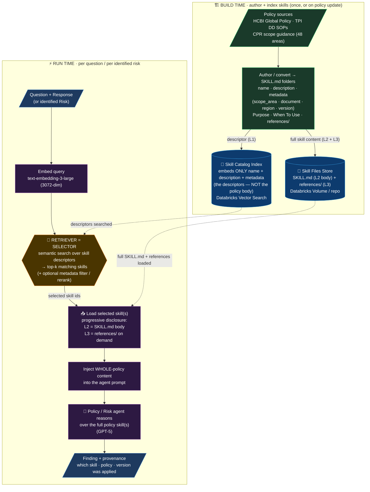

# Policy Layer — Skills as the Knowledge Unit, Retrieval as the Selector

How the policy/SOP knowledge layer works when policies are packaged as **Skills** (SKILL.md
folders) instead of RAG chunks — while retrieval is retained purely to **select which skill to
load**. This keeps our current stack (LangChain · Azure OpenAI GPT-5 · Databricks) and gains the
governance/defensibility benefits of the Skills pattern.

---

## The core idea

- **Skill = the knowledge unit.** Each policy / SOP / CPR scope is a self-contained folder:
  `SKILL.md` (name · description · metadata · Purpose · When To Use) + a `references/` folder with
  the full policy content. The *whole* policy is the unit — not fragments.
- **Retrieval = the selector only.** We do **not** embed the full policy text. We embed only each
  skill's **descriptor** (name + description + metadata) into a small "skill catalog" index. At
  query time we semantically match the question/risk to the right skill(s), then **load those whole
  skills** into the agent's context (progressive disclosure).

So retrieval never returns policy *content* — it only answers *"which policy skill(s) apply here?"*.
The agent then reasons over the complete, versioned policy.

---

## Flow diagram

---

## Step-by-step

**Build time (once, or whenever a policy changes)**
1. **Author skills** — each policy / SOP / CPR scope becomes a `SKILL.md` folder: frontmatter
   (`name`, `description`, `metadata`: scope_area · document · region · version), a **Purpose** and
   **When To Use** section, and the full policy text under `references/`.
2. **Index descriptors only** — embed each skill's **name + description + metadata** into the
   **Skill Catalog Index** (Databricks Vector Search). The policy *body* is **not** embedded.
3. **Store skill files** — the `SKILL.md` bodies and `references/` live in a Databricks Volume /
   repo, loaded on demand.

**Run time (per question, or per identified risk)**
4. **Embed the query** — the question + response (or an identified risk) is embedded.
5. **Select (retrieval)** — semantic search over the **descriptor** catalog returns the top-k
   matching skills; optional metadata filter (e.g. region) or rerank refines it. This is the *only*
   place retrieval is used, and it returns **skill IDs, not content**.
6. **Load skill(s)** — the selected skills' full `SKILL.md` body (L2) and, on demand, their
   `references/` (L3) are loaded — progressive disclosure keeps context lean.
7. **Inject + reason** — the whole-policy content is injected into the agent prompt; the agent
   performs its analysis against the complete, versioned policy.
8. **Output with provenance** — the finding records **which skill / policy / version** was applied
   (clean audit trail), and this provenance can be written to the OTEL observability store.

---

## How this maps to our current stack (no framework migration)

| Concern | Implementation on LangChain + Azure GPT-5 + Databricks |
|---|---|
| Skill authoring | `SKILL.md` folders per scope/policy in a Databricks Volume / repo |
| Skill Catalog Index | Databricks Vector Search over **descriptors** (name + description + metadata) |
| Selector | our existing semantic retriever, pointed at the catalog (top-k + metadata filter) |
| Skill loader | small custom step: read selected `SKILL.md` + `references/`, inject into prompt |
| Progressive disclosure | load L2 body always; load L3 `references/` only if the agent needs more |
| Provenance | log skill name + version + model id to the OTEL / Feedback (Lakebase Postgres) stores |

> Native Skills loaders exist in the Claude Agent SDK and Google ADK; on our stack the loader
> (steps 5–6) is a thin custom component. The pattern is identical — only the "who loads it" differs.

---

## What changes vs today's RAG

| | Today (RAG) | Skills + retrieval-as-selector |
|---|---|---|
| What is embedded | Policy **chunks** (fragments) | Skill **descriptors** only |
| What retrieval returns | Text fragments | **Skill IDs** → then load whole policy |
| Unit the agent sees | Assorted chunks | The **complete, versioned** policy |
| Fidelity | Can miss clauses across chunks | Full policy — no missing clauses |
| Provenance | "chunks retrieved" | "policy X vN applied in full" |
| Editing | Re-chunk + re-embed | Edit one `SKILL.md` folder (SME-friendly) |
| Scale | Excellent for huge corpora | Best for a bounded, named set (our 48 fit) |

---

## Design notes (important for Risk Analysis)

- **Selection ≠ scope-first.** Match skills by **risk/topic semantics**, not by a pre-assigned
  scope area. This keeps the "assign scope *after* risk analysis" decision intact — the selector
  can return **cross-scope** skills, and a risk type may draw on several.
- **Retrieval does not disappear** — it is the selector. "Skills not RAG" here means *package whole
  policies as skills; use retrieval to choose which to load*, not *remove retrieval*.
- **Progressive disclosure controls cost** — load only the selected skills' bodies; pull `references/`
  only when the agent needs deeper detail.
