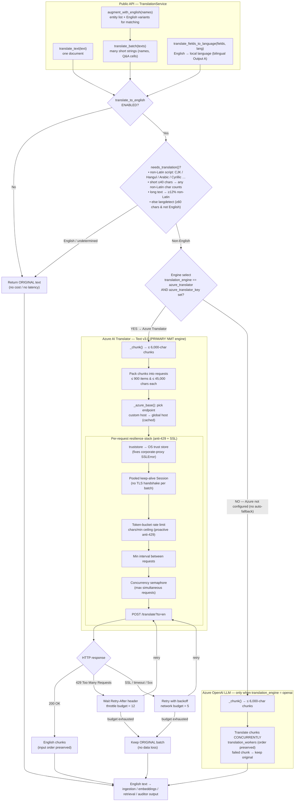

# Translation Service — Architecture & Flow

`src/services/translation.py` auto-detects any **non-English** text entering the system (supporting docs,
SI/Legal/Additional-Input/past-audit knowledge, questionnaire Q&A, TPI inventory names) and translates it
to **English** so retrieval, reasoning, scope/keyword matching and the auditor-facing output are all in one
language. English / Latin-script text is passed through untouched (no cost, no latency). Everything is
**best-effort**: any failure keeps the original text so an ingestion run never breaks.

## Flow

## Key guarantees

- **One language end-to-end** — all retrieval/reasoning/output in English; genuine local text can also be
  rendered back into the audit's local language for bilingual Output A (`translate_fields_to_language`).
- **Best-effort, never breaks a run** — every failure path keeps the original text (no data loss).
- **No OpenAI fallback for the Azure engine** — when `azure_translator` is selected, translation relies
  solely on the translator key; a failed batch keeps its original text.
- **Anti-429 by design** — proactive pacing (token bucket + interval + concurrency cap) keeps us under the
  tier's chars/min quota; `Retry-After` is honoured when throttled.
- **Corporate-proxy TLS safe** — `truststore` validates against the OS trust store; pooled keep-alive
  connections avoid the `UNEXPECTED_EOF` resets.

## Configuration — environment-overridable settings

| Setting (env var) | Default | Purpose |
|---|---|---|
| `translate_to_english` (`TRANSLATE_TO_ENGLISH`) | `true` | Master on/off for all translation |
| `translation_engine` (`TRANSLATION_ENGINE`) | `azure_translator` | `azure_translator` (NMT) or `openai` (LLM) |
| `azure_translator_endpoint` (`AZURE_TRANSLATOR_ENDPOINT`) | `""` | Custom Translator resource host (falls back to global) |
| `azure_translator_key` (`AZURE_TRANSLATOR_KEY`) | `""` | **Required** to enable the Azure engine |
| `azure_translator_region` (`AZURE_TRANSLATOR_REGION`) | `eastus` | `Ocp-Apim-Subscription-Region` header |
| `translation_max_concurrency` (`TRANSLATION_MAX_CONCURRENCY`) | `1` | Max simultaneous Azure requests across all workers (anti-429) |
| `translation_min_request_interval` (`TRANSLATION_MIN_REQUEST_INTERVAL`) | `1.0` s | Minimum gap between consecutive requests (anti-429) |
| `translation_chars_per_minute` (`TRANSLATION_CHARS_PER_MINUTE`) | `900000` | Sustained chars/min ceiling — primary anti-429 pacing |
| `translation_workers` (`TRANSLATION_WORKERS`) | `6` | Concurrent chunk translations on the **OpenAI** engine |

## Configuration — tunable code constants (`translation.py`)

| Constant | Default | Purpose |
|---|---|---|
| `_MIN_NONLATIN_RATIO` | `0.12` | Long text: translate only when ≥12% chars are non-Latin |
| `_SHORT_LEN` | `40` | ≤40 chars: any non-Latin char triggers (names/cells) |
| `_LANGDETECT_MIN_CHARS` | `60` | Minimum length to run langdetect (Latin-script foreign) |
| `_BATCH_SHORT_LEN` | `200` | Strings ≤200 chars use the JSON batch path (OpenAI) |
| `_DOC_CHUNK_CHARS` | `6000` | Per-call chunk size for long documents |
| `_BATCH_SIZE` | `40` | Unique short snippets per OpenAI batch call |
| `_AZURE_BATCH_CHARS` / `_AZURE_BATCH_ITEMS` | `45000` / `900` | Azure per-request char / array limits |
| `_AZURE_MAX_RETRIES` / `_AZURE_RETRY_BACKOFF` | `5` / `2.0` s | SSL/network/5xx retries + backoff |
| `_AZURE_THROTTLE_RETRIES` / `_AZURE_THROTTLE_MAX_WAIT` | `12` / `60` s | 429 retries (honours Retry-After) + wait cap |
| `_AZURE_BUCKET_BURST_SECONDS` | `2.0` s | Token-bucket burst allowance |
| `_AZURE_CONNECT_TIMEOUT` / `_AZURE_READ_TIMEOUT` | `10` / `180` s | Per-request connect / read timeouts |
| `_AZURE_GLOBAL_ENDPOINT` | `https://api.cognitive.microsofttranslator.com` | Fallback translator host |
| `_PROGRESS_EVERY` / `_AZURE_PROGRESS_EVERY` | `10` / `10` | Progress log cadence (chunks / batches) |
